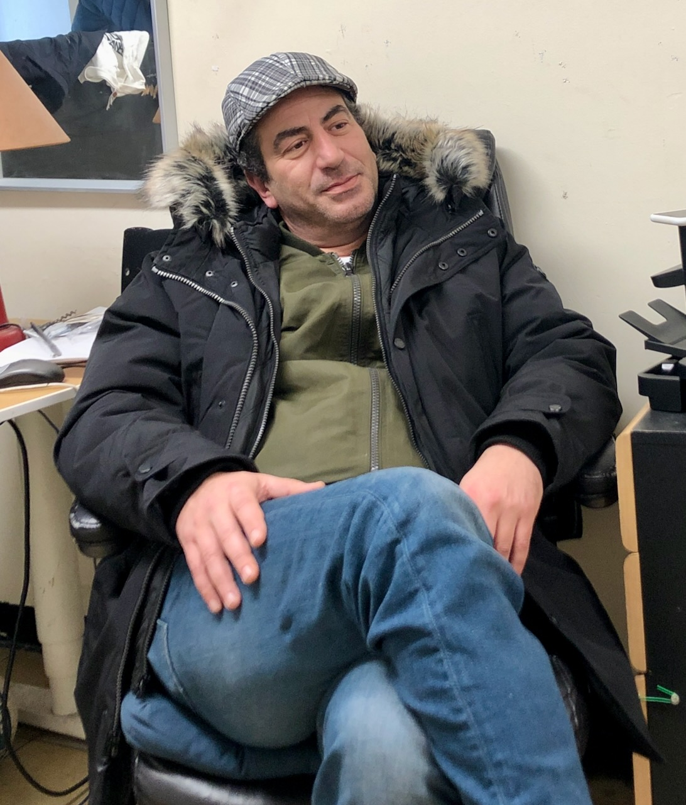

# Frank Galeano

I have all sorts of stories I could tell you about Frank. But I guess I'd better
start with just one. 

Frank's brother-in-law was, and maybe still is, a moderately big player in New
York City real estate. For instance, one time I met him with Frank when he was
looking at buying an entire city block. I don't know if he went through with it,
but he's the kind of guy who could seriously contemplate it. 

In any case, his brother-in-law was accused by a tenant in one of his buildings
of nailing his tenant's hand to the floor of his apartment with a nail gun. (In
the end, he got off: his lawyer convinced the jury that the tenant had nailed
his own hand to the floor!)

So his brother-in-law was in jail, waiting to be bailed out. Being a wealthy
guy, he had a fair amount of cash on hand. Frank picked up the appropriate
amount from his sister, and brought it down to the bail office, or whatever the
place you bail people out is called. Apparently, the wait was immense, and Frank
wound up chatting with a bunch of the other guys hanging around waiting to bail
somebody out. (You will later find it important that, in general, the people
posting bail were themselves not an entirely law-abiding group.) After they
chatted for a bit, Frank asked if anyone wanted to go out for a smoke. A few
guys came out with him. They had cigarettes and went back in. More time passed,
and he and his new friends took a smoke break again, and probably a couple more.

Finally, Frank is called up to the window to post bail for his brother-in-law.
The "bail lady" says, "Okay, that's either title to a piece of real estate worth
at least $250,000, or $100,000 cash."

Frank told her, "I have the cash."

Apparently, as soon as he said it, the fellows who he had been hanging out and
chatting with for hours started whooping and slapping their legs in disbelief.
Probably at least some of them were low-level criminals who had robbed someone
for a couple of hundred dollars at some point, and here they had been passing up
the opportunity to rob someone who had $100,000 in his pocket. 
