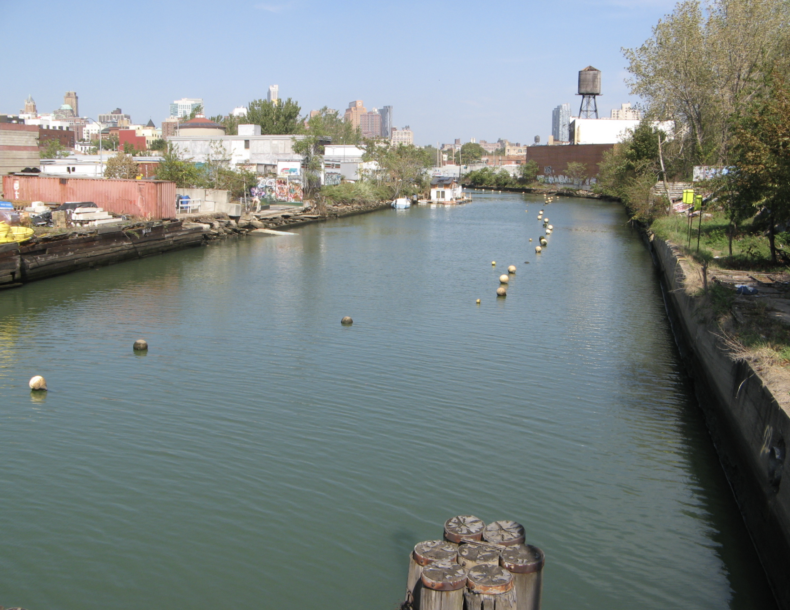

# My swimming challenge

*"The Gowanus Canal: the only body of water in the world that is 90 percent guns" -- Jonathan Lethem*

[Frank Galeano]()
sent me out to pick up a signed lease from one of his customers,
Joe Rock. Joe owned a number of buildings in the area, and also operated a card
shop up on Smith Street, as far as I remember. (It might have been Court Street,
but I don't think so.)

When I arrived at the card shop, I introduced myself to Joe, and told him I had
come to pick up the lease for Frank. 

Joe said to me, ""Here are the keys to my car. It's that Porsche a few buildings
down that way. The lease is on the front seat."

I said, "Great. Oh, and I've never driven a Porsche. Can I take it for a little
spin while I get the lease?"

Joe cocked his head to one side, and asked me, "Can you swim in the Gowanus
Canal?" 

"Sure I could: I used to swim in a muddy ditch in Betty Philcox's backyard, and
the Gowanus Canal ain't half that murky."

Joe's head was now cocked even further to the side, and also tilted back,
waiting with bated breath for what nonsense would come out of my mouth next.

He asked, "Could you swim in it wearing cement overshoes?"

I tried to look contemplative for a moment, and not giggle, which would have
given away how much fun this was. "Well," I said, with my chin resting on my
thumb and forefinger, in a pose somewhat like Rodin's Thinker, "Back in college,
sometimes I used to swim with sneakers on. So I guess I could give it a shot..."

Joe just started laughing: "Just go get the lease, you crazy motherfucker." 
