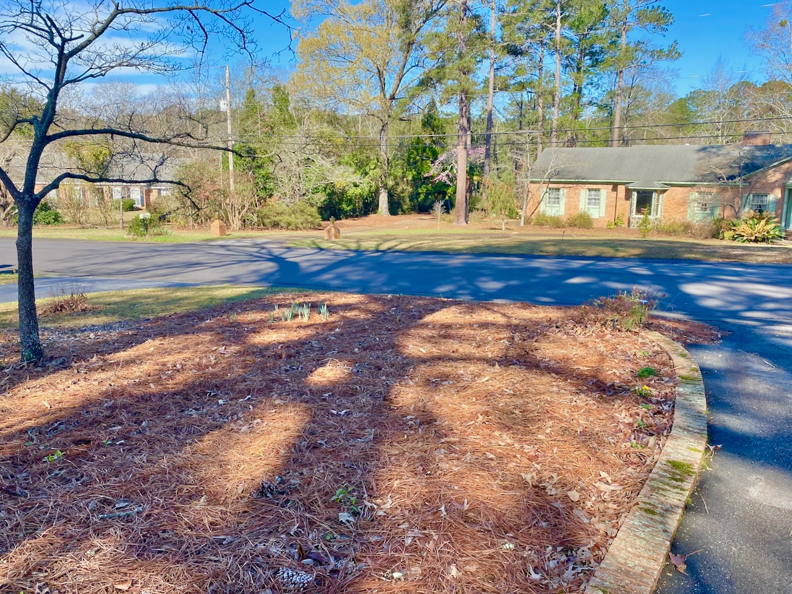

# A South Carolina Musical

The other day, I was thinking about how the state of Oklahoma has its own famous
musical named after it. But my new state does not.

I was working out in the garden at the time, walking around on the magnificent
layer of pine straw that covers all of my garden beds. I asked myself
"What do I know of the musical Oklahoma?"

The two lines I could recall were, "The corn is as high / As an elephant's eye."

Suddenly, words came to me: "The pine straw is as thick / As an elephant's..."

But I just could not come up with a rhyme at the end there. Anyone has any
ideas, send them my way.

