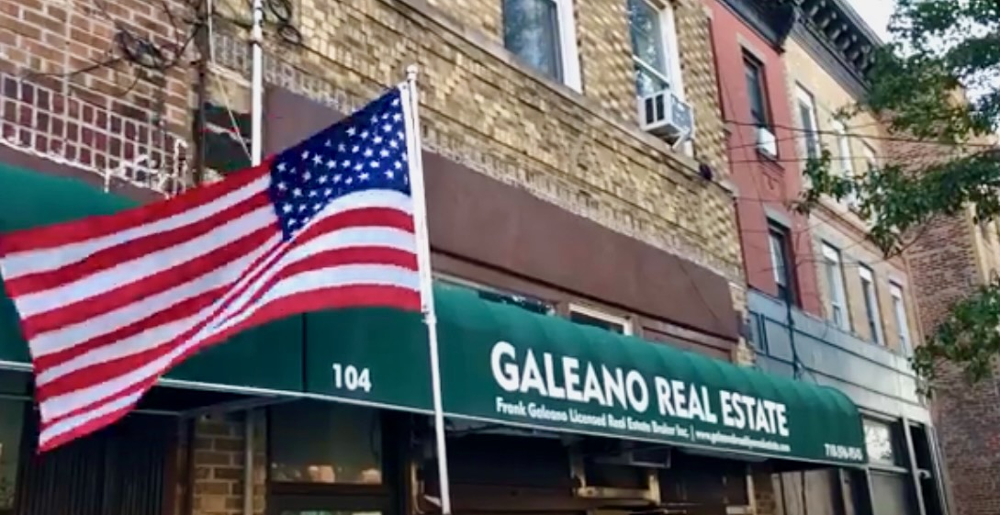

# Arturo Galeano

Arturo is my friend [Frank]()'s
father. He hopped off a merchant marine vessel in,
I believe, Newport News, Virginia, sometime after World War Two, and asked
where he should go to live. He was told there were lots of Italians in
Brooklyn, so he should go there, and he did. 

Arturo is a true entrepreneur, he made his way at first doing things like
selling produce from a street cart. The Columbia Street neighborhood, where he
has lived since he arrived, was a very hazardous place. There was an open-air
drug market and plenty of violence. Because of that, once he got a little money
together, Arturo was able to begin buying three- and four-story brownstones for
$50,000 or $60,000. Well into his 80s, he opened a T-shirt shop next door to
Frank's real estate office. I don't think it did that well, but he was still
trying new ventures. 

By the time I arrived in the neighborhood, he owned, I'd guess, ten or
twelve buildings. He loved to walk the neighborhood in an old T-shirt and some
worn khakis. People who didn't know him and saw him probably thought he was an
elderly pensioner, staying in senior housing nearby, and just scraping by. But
by this point, his real estate portfolio probably was worth north of $20
million.

One day, he told us about how, back in Calabria, they would catch a female
octopus, put her on a hook, and use her to catch male octopuses. After a while,
if no male octopuses came for her, they'd conclude, "This one must be a
nun," and they'd throw her back in. 

He spent a lot of his day in Frank's real estate office. He might do some odd
jobs, like help a customer who came in when all of the actual agents were out.
But mostly he would watch TV and chat with us. 

One day he said to me, "Johnny, there's a customer who wants a studio in the
neighborhood for around $700." 

(Periodically, Frank would say to him, "Dad, you've known Gene for 10 years
now. His name is not John." Statements like that had no impact on Arturo.
Just like telling him that another agent's
adopted daughter was from Honduras did not deter him from calling her "the
little Chinese girl.")

I said to him, "But Arturo, you can't get a studio in this neighborhood for
$700."

He said, "Rent him the room up above the office."

"Arturo, there's no bathroom up there."

"He can use the bathroom down here," he said, pointing to the office bathroom
behind us. 

"There's no shower."

"In Italy, before the war, no one took showers. You know when we would take a
bath?"

"No, Arturo, when?"

"In the summer, in the ocean."

"Well, when he asks where he can shower, I'll tell him, 'In the summer, in the
ocean.' He probably will be fine with that."

