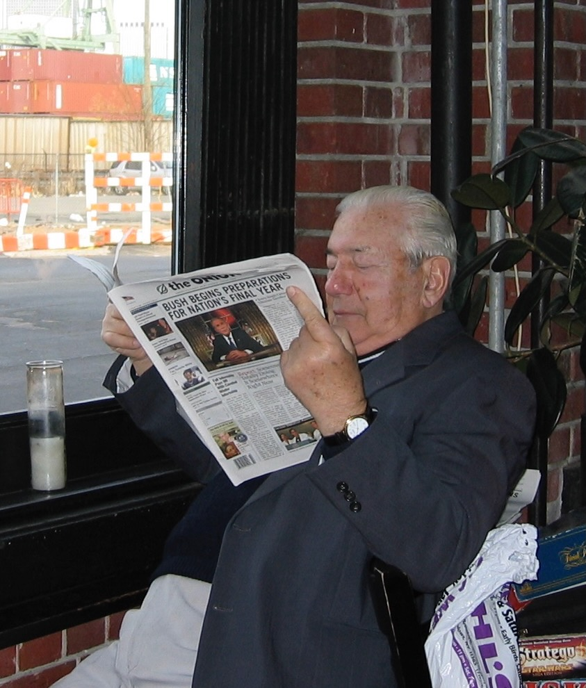
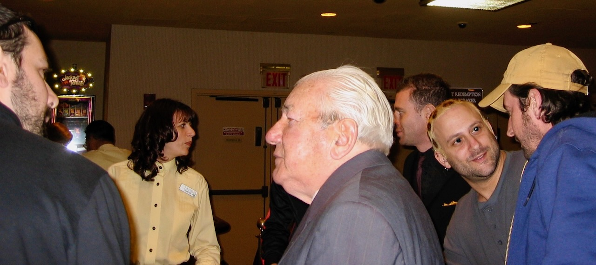
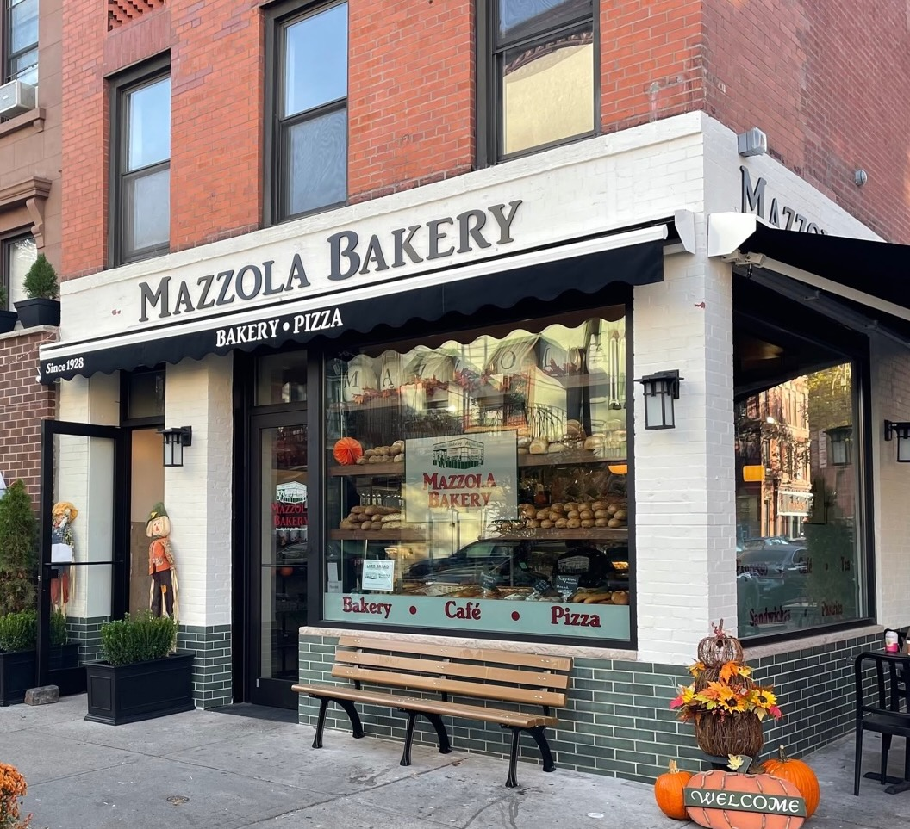

# Peaches

Right about the time we moved to Brooklyn, the Columbia Street waterfront was
just starting to gentrify, turning from the rough, largely Hispanic and
drug-plagued neighborhood that it had been into a place where hipsters could
find cheap studio apartments. Four fellows, who became my friends, opened a
three-story business, with a bar on the first floor, and a Mexican restaurant on
the second floor and on the rooftop. The bar was called B61, and the restaurant
was called Alma.

As far as I know, pretty much as soon as the bar opened, a 75-year-old Italian
man named Peaches began to hang out there, almost every day. He was probably 45
years older than the average age of the people in the bar, and 20 years older
than the next oldest person who would frequent it. He wasn't a drunk; in fact, I
can't recall if I ever saw him drink alcohol at the bar at all. He would sit in the
corner and read the newspaper, even if it was just *The Onion*, and casually
chat with people. He rarely stayed much after dark, and never late at night at
all.

I think the attitude he took towards the bar and its patrons was something like,
"If you don't mention that I'm decades older than most people in this place most
of the time I am in here, I won't mention that all you strange people invaded my
neighborhood. Deal?"

One time, Peach's best friend from Alma, Anthony, one of the owners, walked out
of the building to find Peaches sleeping in his car. Anthony woke him up, and
said, "Peaches, what's up?" 

Peaches told Anthony, "Can you bring me to the restaurant with the big M?"

"Peaches, what are you talking about?"

"You know, the restaurant with the big M!"

Anthony thought for a moment, and then said, "Do you mean McDonald's?"

"Yeah, that one."

Peaches dealt with the issue of keeping track of the names of all these strange
people hanging out at his bar by calling every single male from the bar "Bill,"
and every single woman "Blondie," even if she had jet black hair.

When Peaches was about to turn 80, Anthony asked him what he wanted to do for
his birthday. It turned out he wanted to go to Atlantic City. So about half a
dozen of us got a van together and drove down there with Peaches. When we
entered the casino, to our amazement, it seemed every employee knew him.
"Dominic," they would say, "Where have you been?" This was when I found out his
real name was Dominic.

One day, I was walking down Henry Street, and Peaches was sitting on a bench
outside Mazzola Bakery. I sat down next to him. 

"Peaches, how are you?"

"Good, Bill." He stared off into the distance for a moment. "Did I ever tell you
about the last time I drove?"

"I don't think so." 

"I was racing my car down President Street, going really fast. The problem was,
I forgot they had put the BQE in." (After the BQE was built, President Street,
rather than crossing Hicks and continuing towards the waterfront, came to an
abrupt halt at a thick brick wall.) "Next thing I know, bam!... I totaled that
car on that brick wall. Never drove again."

RIP Peaches.

