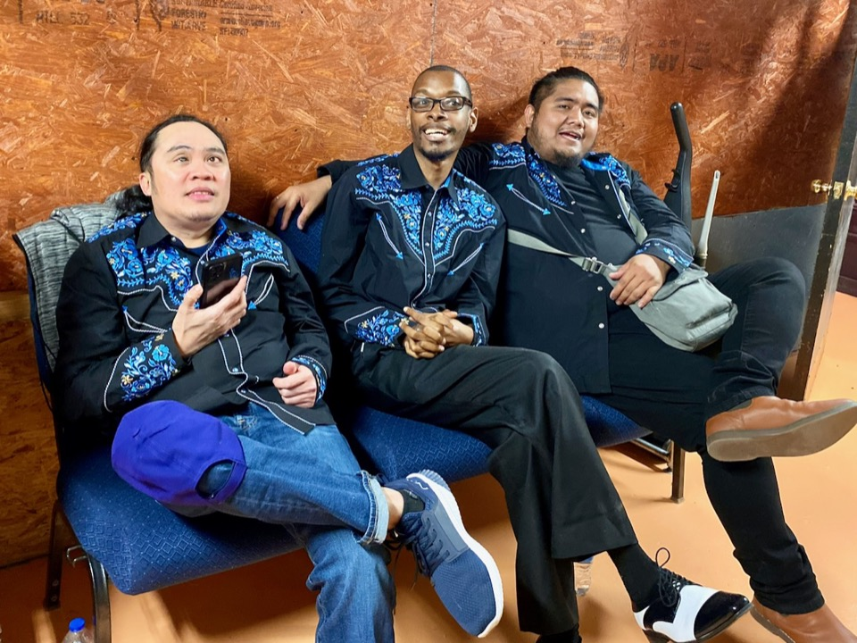

# What About Me?

*Onal, Mike, and Hubert at Bill's Pickin' Parlor*

I was invited to play with some Filipino fellows I had met, at a party thrown
by the local Filipino Association.

When I sat down to play with them, as a percussionist, the first thing I try to
do is connect with the drummer. I kept looking over at the drummer, trying to make
eye contact. After a little while, I thought to myself "This guy doesn't like me
being here: he won't even look at me."

When the band took a break, the lead singer walked over to where I was sitting,
leaned over, and said "I forgot to tell you: the drummer is blind."

That certainly explained why he wasn't making eye contact! His name was Onal
Castaneda, and we became good friends.

I had a chance, a few years later to describe that incident to Onal and his wife
at his going-away party, when he was moving back to the Philippines.  I had never
really thought about the incident from his point of view, but his wife said
"Yes, on the set break, Onal said to me 'There were a bunch of different sounds
happening in the music: where were they coming from?'" I guess, besides
forgetting to tell me that the drummer was blind, they forgot to tell the
drummer that there would be a percussionist joining them.

We wound up forming a country band, because another friend of ours loved to sing
country songs, and we got a regular gig at Bill’s Pickin' Parlor in West Columbia.
One Saturday we finished our first set, and I think everyone was pretty excited,
because we had played well. We jumped off the stage and kind of rushed to go sit
down in the backstage room. But as we were passing through the door to go
backstage, we heard "Hey hey, what about me?"

My friend Hubert said, "Kuya, we forgot Onal!"

He was still sitting behind the drum set, with no possibility of getting off the
stage on his own: a stage like that is littered with cables, amps, guitar
stands, mic stands, etc.

And Hubert told me this had happened once before where they had left Onal
stranded in some situation he could not walk out of on his own while playing a
gig, and Onal actually had to call Hubert to come get him.

When I told my friend [Gerry Scott]()
this story, he said "Oh, we did the same
thing to Stevie Wonder once: it was a benefit concert, and we had to rush to
get each band up on stage after the last. We got the Red Hot Chili Peppers set
up, and they started playing, when someone noticed that we had left Stevie up on
the platform from where he had been singing and playing keyboards. Since the
Chili Peppers had already started playing, we just had to leave him there until
they were done."

In any case, I wrote this song for Onal before he left for the Philippines:

## What about me

Playing down at Bill's on Saturday night   
The crowd was all dancing, feeling right  
The music was so hot  
The band didn't give it a thought   
And left me all alone behind the drums   

Singin'...  

Hey hey hey, what about me?  
Did you dumb shmucks forget that I can't see?  
You left me on the stage   
Just to shout and rage   
Hey hey hey, what about me?   

After that night, you think they learned their lesson?   
Then you don't know my friends, and that's a blessin'  
They rushed off for a drink  
Man they didn't even think  
And I had to call Hubie up on my phone  
And say...  

Hey hey hey, what about me?  
Did you dumb shmucks forget that I can't see?  
You left me on the stage   
Just to shout and rage   
Hey hey hey, what about me?   

