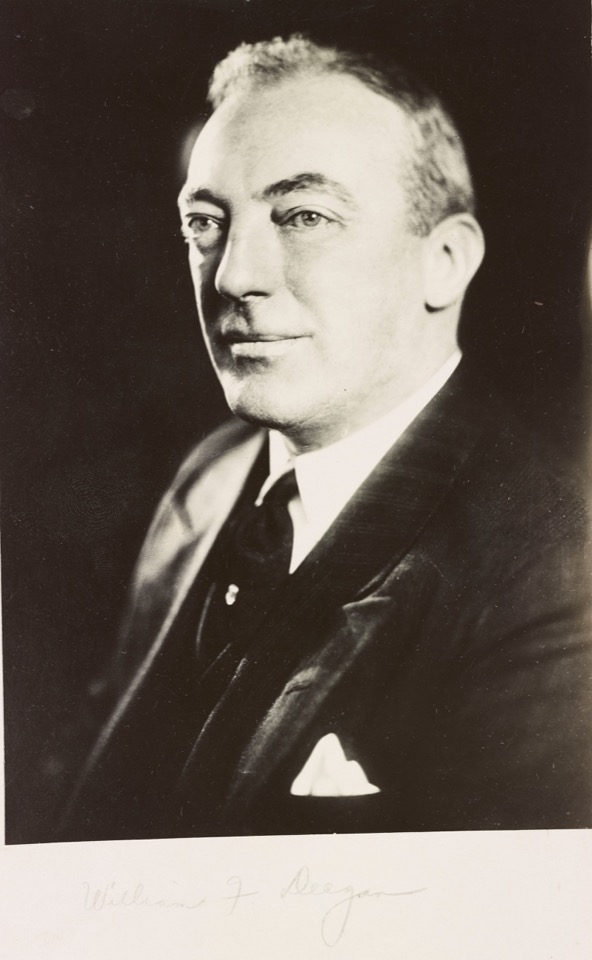

# The Crazy Generations

*Major William F. Deegan. Photo: NYC Department of Records*
{: style="text-align: center; margin-top: -1rem"}

The generation of my family before me was fairly "respectable." They were often
interesting people with real accomplishments in life, but for the most part,
nobody did anything too crazy. 

The generation or two before them was not like that. First of all, let's talk
about Grandpa and Great-Grandpa Callahan. The entire time my father was growing
up, he lived in the same town as his grandfather, and never met him. That was
because his father and grandfather had feuded at some point, and never spoke
again as long as they were both alive.

On the other side of the family, we can start with Major Deegan. He was a
prominent architect in New York City, housing commissioner, and friend of
Fiorello LaGuardia. One day, his wife vanished. And so did the husband of a
woman in their New York City social circle.

It was rapidly determined that they had vanished together, and they were subject
to a nationwide police hunt, because both Major Deegan and the aggrieved woman
filed legal complaints for alienation of affections against their vanished
spouses.

Major Deegan died young, which is how he got a highway named after him. Many
years later, my grandfather met a woman who introduced herself as an old friend
of the family. After they got to know each other for a while, she announced that
she was actually his mother. She was my only living great-grandparent when I was
born, and I remember her fairly well. She seemed like the epitome of a quiet
Victorian lady, and her house was like a museum of Victorian knickknacks. It was
hard to imagine that this was the woman who had such a passionate affair that
she risked prison to carry it out. 

And my grandmother Deegan, née Tansy, never knew either of her parents. They
weren't married when her mother became pregnant. The story that went around was
that her father was beheaded by a train he was trying to catch, but that always
struck me as suspicious. In any case, when she was born, her mother handed her
to her grandparents, who lived in Oxford, New York, and announced she was taking
off. Uncle Walter ran into her years later in Rochester, New York, but my
grandmother had no interest in meeting her. 
