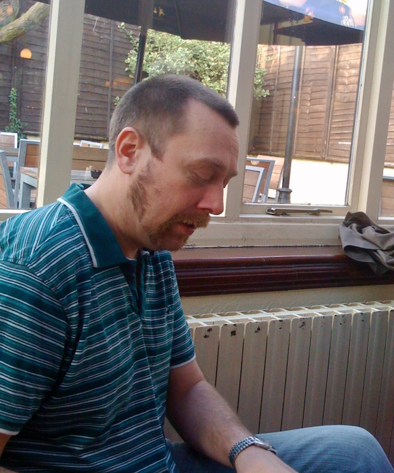
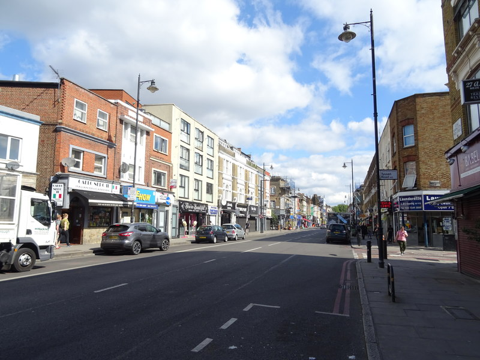

# Howie

I was sitting in the Coach and Horses pub, in the Stoke-Newington neighborhood of
London. I saw the barmaid serve someone a pint glass with a pink liquid in it.

Curious, I asked, "What is that pink drink you just served?"

"A snakebite... It's lager, cider, and a shot of black currant juice."

"Let me try one."

As I'm drinking it, a fellow sits down next to me. He looks at what I'm
drinking, and says, "Ah, you're a punker!"

I had no idea at that moment, but it turns out that snakebites are a
traditional drink of London punk rockers. In fact, formerly they also contained
a shot of gin. But serving gin in the drink was banned, because the punkers
would have so many fights in the pubs. Of course, they could still order the
shot of gin alongside their snake bite, and then dump it in themselves, so I
don't think it actually prevented many fights.

In any case, I pretended I knew what the man next to me was talking about. We
wound up chatting for a while, and then taking a ride to another part of London,
during which he pointed out to me how much he loved the rooftops of the city. 

Howie was one of the last remaining survivors of the 1970s and 80s
Stoke-Newington punk rock scene. One night, I wound up, sitting at a table in
the pub with him and two of the other survivors, a Scottish fellow and a Welsh
fellow. The Welshman asked me about the philosophy program I was in.

"Are you studying Socrates, Plato, and Aristotle?"

"No, we aren't."

"Then your philosophy program is shite, mate."

He then told a hilarious joke, or hilarious to me and everyone else at the
table, at least. It has the interesting property that when I have retold it,
people either also find it really funny, or they find it not funny *at all*. 

*Stoke Newington High Street. Photo: [JThomas](https://www.geograph.org.uk/photo/6206288), [CC BY-SA 2.0](https://creativecommons.org/licenses/by-sa/2.0/)*
{: style="text-align: center; margin-top: -1rem"}

Howie had lots of great stories. He told me about the time he had wandered into
what was an almost all-Irish pub. The people in the pub kept talking trash about
the English, to the point where Howie got sick of it. So he started singing, "Do
you want a chicken sandwich, Bobby Sands?" (Bobby Sands was an IRA member who
died on a hunger strike in a British prison.) He told me, while laughing, "Gene,
I've never been beat up so badly in my life." 

We were once in his flat watching TV late at night. Or at least I was watching,
while Howie was distracted. The news was on, without much volume, and the
picture showed a South Asian parliament, with a bunch of people having a melee
in the middle of the parliament floor. 

I asked Howie, "What do you think is going on here?" 

He looked at the TV for just a moment, then shrugged, and said: "Foreigners."

The sentiment was that there was absolutely no telling what foreigners might get
up to, so why even bother trying to figure it out.

After I returned to the U.S., Howie and his girlfriend made it over to New York
City once, and we got to have a good night out on the town, ending in the
Dominican dance club down the street from me at 3 am. 

