# Milford

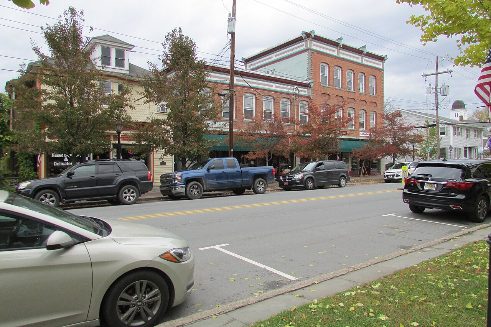

*Broad Street, Milford, Pennsylvania. Photo: [Chris Light](https://commons.wikimedia.org/wiki/File:Broad_Street_2018-10-30_501.jpg), [CC BY-SA 4.0](https://creativecommons.org/licenses/by-sa/4.0/)*
{: style="text-align: center; margin-top: -1rem"}

We first saw the house we owned in Milford, Pennsylvania, in March, I believe.
We closed on it in April, and visited that day. I believe it was the 15th of the
month, and there was still 2 feet of snow on the ground. 

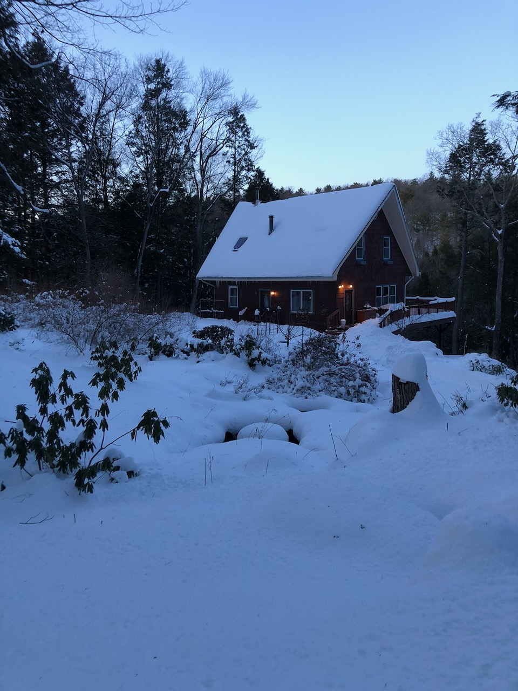

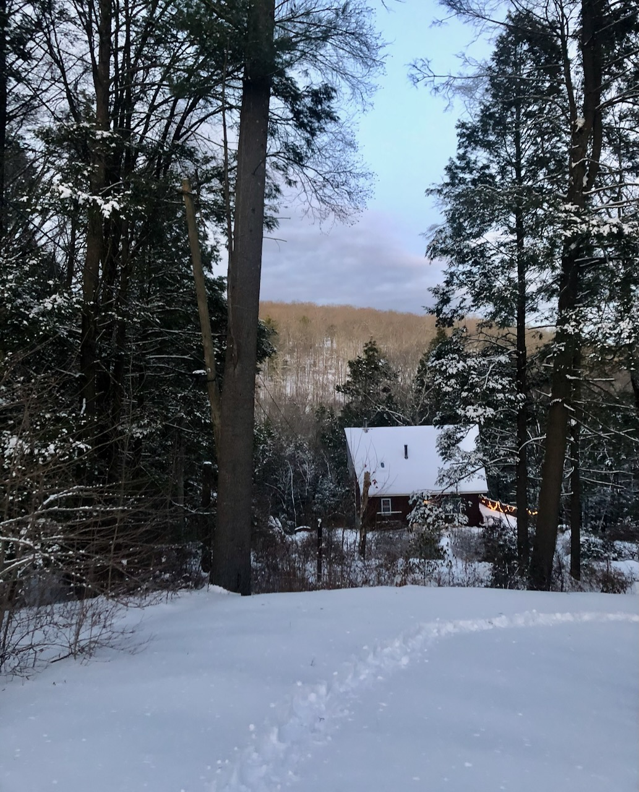

We went back with our friends Tom and Jennifer on May 15. We hiked up the
Sawkill Creek to one of the waterfalls nearby, and in the gorge into which the
waterfall plunged, there was still snow on the ground. 

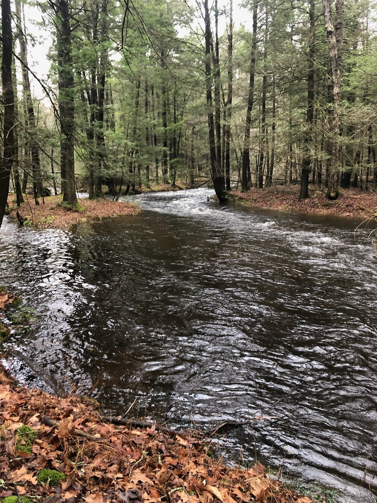

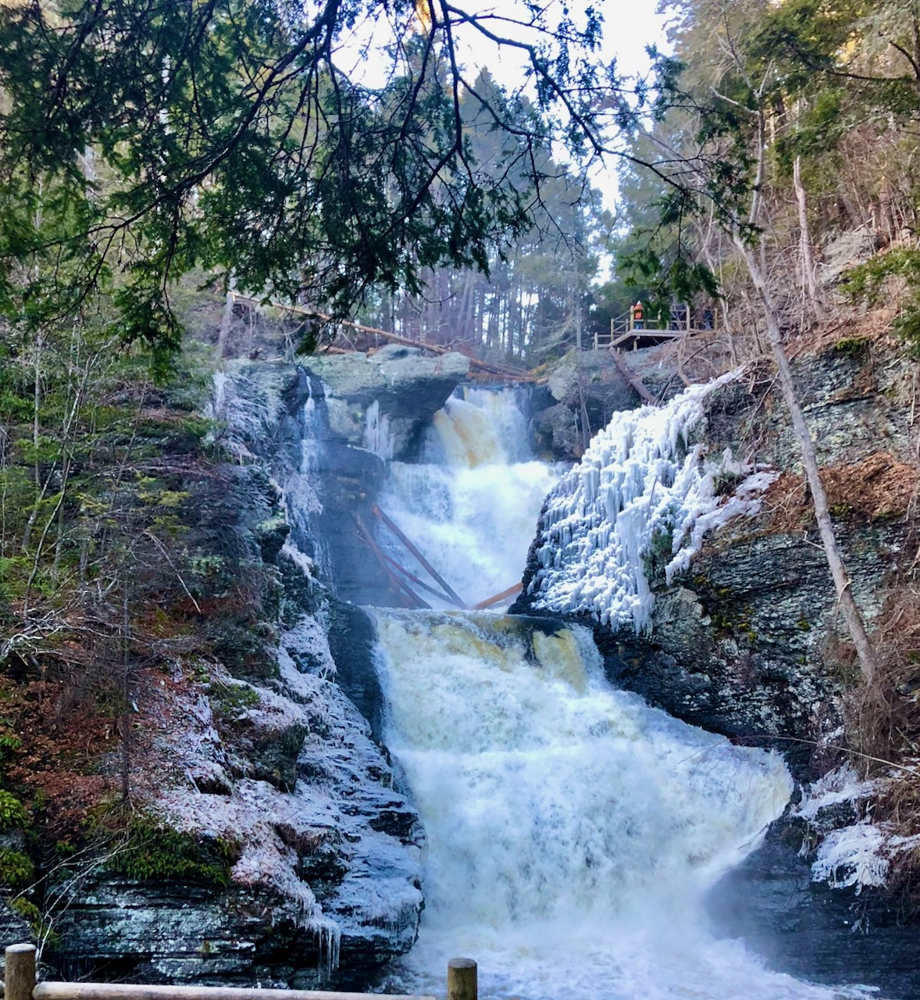

We owned the house for 15 years, during which time I continually worked on the
property, landscaping what of it I could. (We had 10 acres, half of which we
hardly ever visited, because it was on the other side of the creek. My
landscaping was confined to 1 or 2 acres out of the total.)

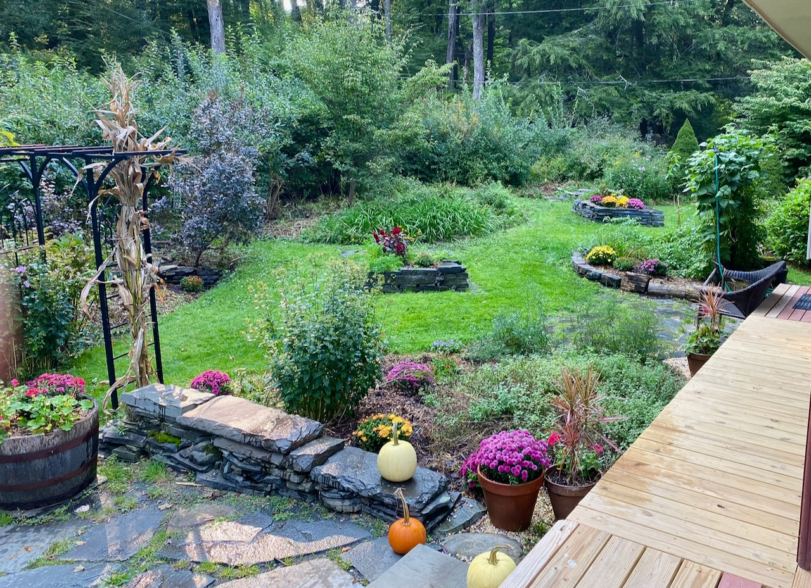

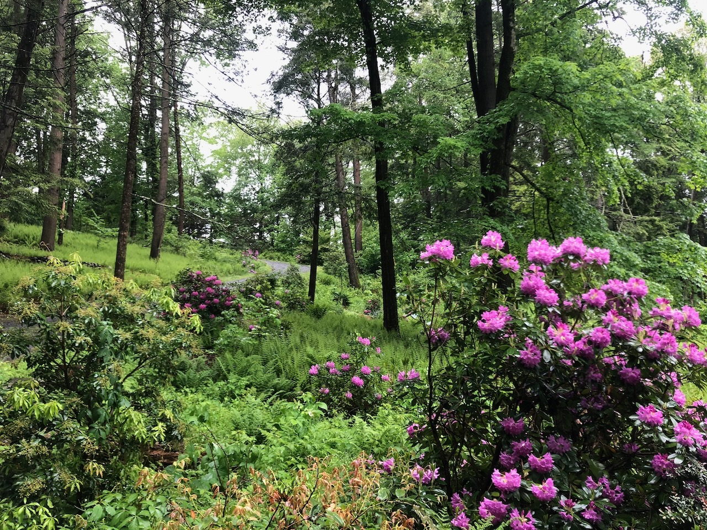

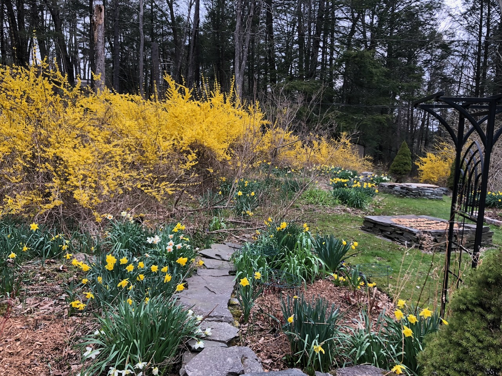

The property was kind of like a V-shape with the Sawkill Creek at the bottom of
the V. Because of the steep slope that the house was set on, in the winter, we
parked up by the road, and had a 400-foot hike down to the house. We had to keep
snowshoes in the car, and a sled at the top of the driveway, so we could bring
groceries down to the house. 

Although the terrain was a little rough, it meant that we had fantastic views
from our back porch. 

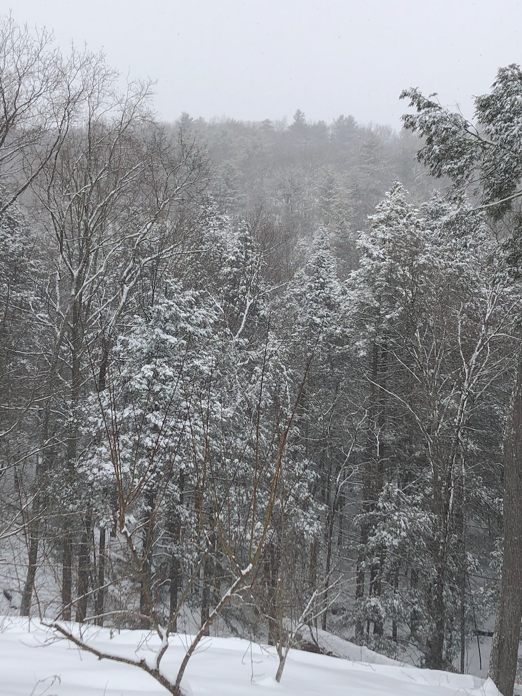

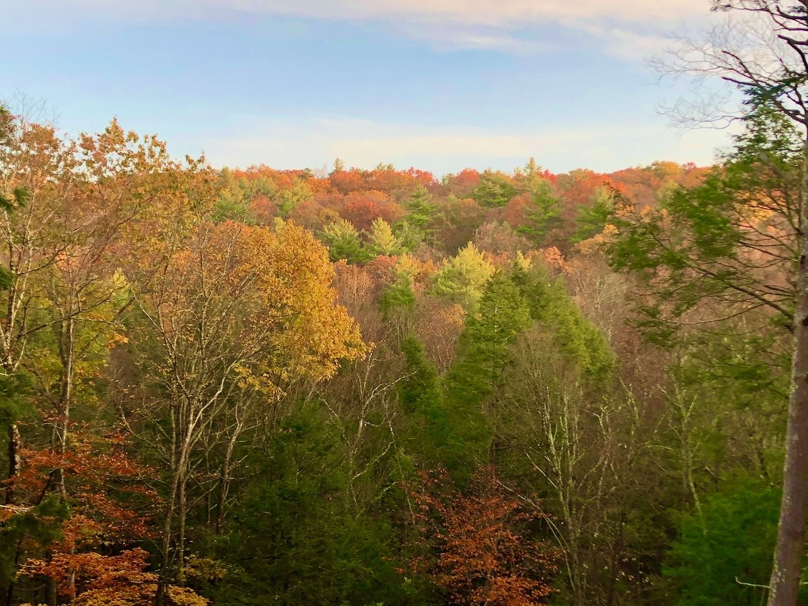

Another great feature of the place was the amount of wildlife that came by. Here
is a bear rummaging in our backyard, and a rattlesnake crossing our driveway. 

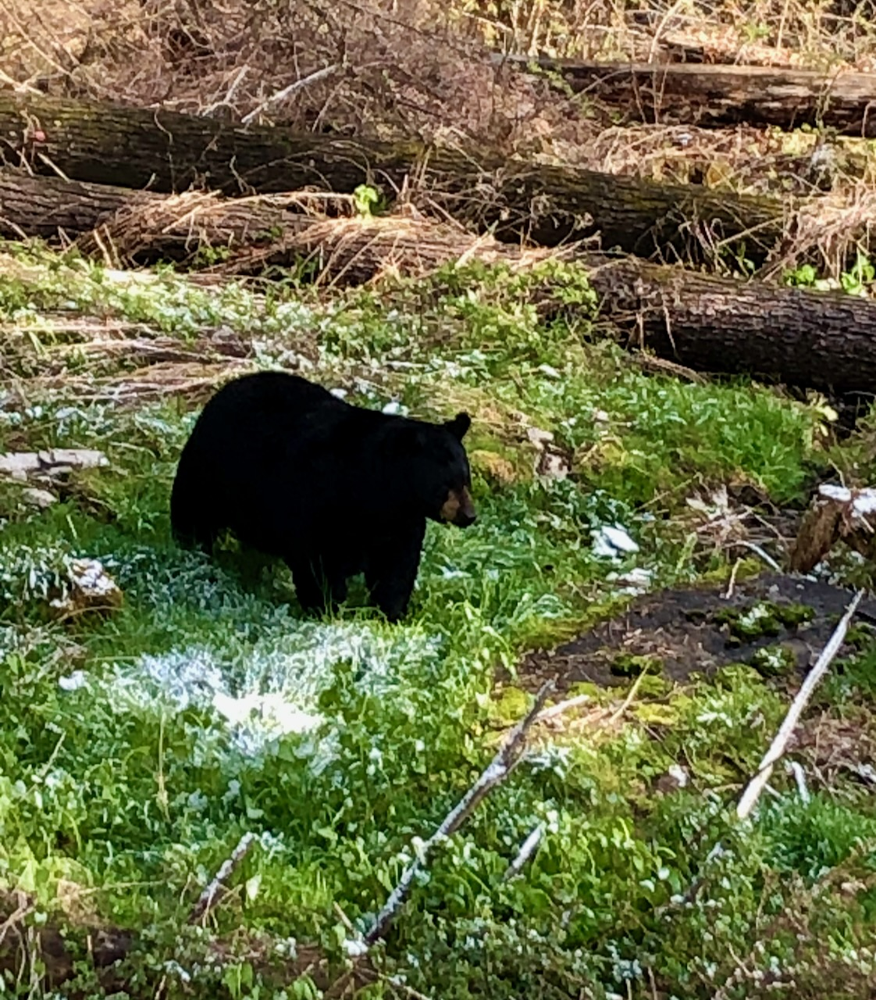

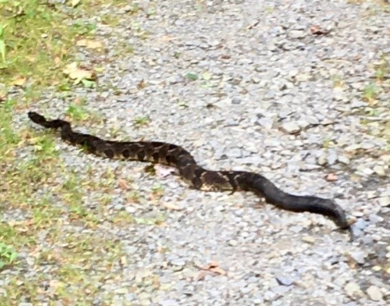

It was a little sad to let the house go, but South Carolina was calling, and
there was family to take care of.

