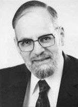

# Israel Kirzner

Professor [Israel Kirzner](https://en.wikipedia.org/wiki/Israel_Kirzner) has been not only a world-class economist, but also a
notable Jewish rabbi, and he raised 13 children to boot. I only met Professor
Kirzner towards the end of his teaching career, but I was lucky enough to see
him in person weekly at the NYU colloquium on market processes for several
years. (And although I consider him my friend, I have never called him anything
but "Professor Kirzner." I am shocked by the rudeness of some of his juniors who
would call him, for instance, "Izzy.")

Professor Kirzner was, for me, a model of academic integrity and of how to be a
serious scholar while remaining humble. He was able to strongly disagree with
someone without ever becoming abrasive or strident. 

He was also such an example of moral integrity that, without ever raising his
voice or becoming "moralistic," everyone felt they had to behave better around
him. I remember Sandy Ikeda telling me the story of a conference he was at that
was also attended by Kirzner and [Ludwig Lachmann](https://en.wikipedia.org/wiki/Ludwig_Lachmann). It was getting late on a
Friday afternoon, and, before the sun set, Kirzner got up from the discussion to
go back to his room before the Sabbath began. He looked at Lachmann, who was
also Jewish, and said, "Are you coming?"

Despite the fact that Lachmann was over two decades older than Kirzner, Sandy
told me that he immediately got up, saying, "Yes, Israel, of course."

About 10 minutes later, he slipped back into the room, but with the
admonition to everyone there: "Do not tell Israel that I came back!"

He had the same effect at the NYU colloquium: I remember he showed up
unexpectedly one day, at a period when his appearances had become less frequent,
and several people suddenly felt they might have behaved less well than if they
had known he would be there. For instance, when Kirzner got off the elevator,
one friend of mine leaned over to me and said, "Oh my, Kirzner is here, and I
wore shorts today." And you have to realize that Kirzner never would have
chastised him for doing so: he might merely have looked over at him with the
slightest hint of disapproval. But that was plenty to get people to behave
themselves.

The last time I saw him, we both had the same comments to make about the paper
being presented. We left the colloquium and happened to ride down the elevator
together, along with Sandy. Professor Kirzner said to me, "Gene, it is really
good to see you." Then he linked his arm with mine, and we walked down the New
York City sidewalk arm in arm.

I am going to try to find him when I am in New York this week and see him one
more time, to thank him for what he has done for me. 

