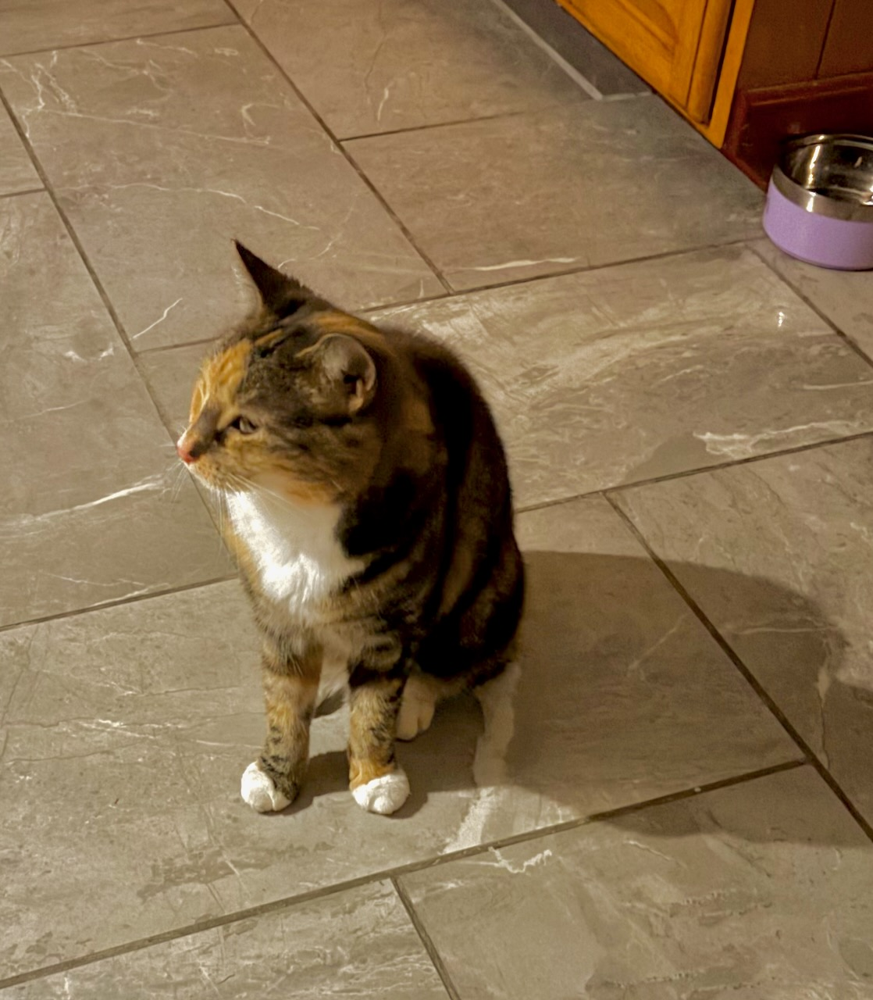

# Etti

Etti is certainly the strangest cat I have met. (Her name has that strange
spelling because it is short for "spaghetti.") Elen got her as a rescue cat.
When she picked Etti up, Etti kind of melted in her arms, and they bonded. 

She came from an apartment in Port Jervis, New York, where she lived with 17
other cats. Something or other went on there that formed her in a remarkable
way. 

For instance, the first two weeks she lived in our house, she hid in the rafters
of the basement. I think she was hiding from me, since she had already bonded
with Elen. And this is pretty much her reaction to any person who she hasn't had
several weeks to get to know. 

When any stranger whatsoever arrives at our house, if she is outside, she won't
come in. If she is inside, she finds a place to bury herself, like in one of the
drawers of my bathroom vanity. She also likes to pull the grates off the air
vents in the floor, and try to crawl into the ventilation system. 

If she knows there have been strangers in the house, but she's not sure if they
are still there, she will be very cautious entering. She creeps up to the door,
both listening and sniffing. The slightest hint that someone is still there, and
she will dash away.

She also likes to have someone watch her eat. We know this, because she will
come fetch one of us, and bring us to the kitchen. When we get there, she still
has plenty of food in her bowl, but as long as we are watching her, she'll
crouch down and eat. If we leave, she may come get us again so we can watch her
finish. 

Despite her apparently timid nature, she is also an enthusiastic killer of small
creatures. She brings us mice, voles, shrews, lizards, baby rabbits, baby
squirrels, and small snakes. One day, she left the head of a baby rabbit on the
lawn for me to stumble across as I worked in the garden. 

