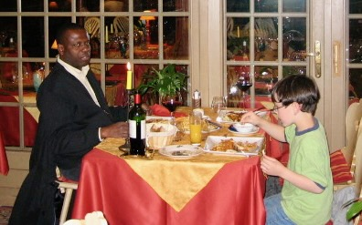
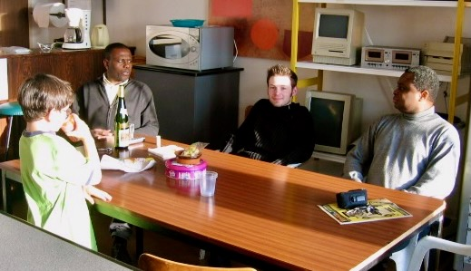

# Rudolph Sock

One of my New Haven housemates, Martin Obeng, met Rudolph on the bus in New
Haven, and recognized that he was from West Africa. They struck up a
conversation. Rudolph started coming over to our house on Willard Avenue, and
he and I rapidly became friends.

Rudolph had come to New Haven from France, to do postdoctoral work in linguistics
at Yale. He was from upper-class Gambian society, a fact which my friend Dellie
immediately recognized, as he always referred to him as "King Rudolph." Rudolph
would periodically check the news from Gambia, he told me, "to see if my brother
is finance minister again, or in prison." (As Gambia underwent various coups,
his brother would fall in and out of favor with the rulers.)

He came to my bachelor party, and he stayed over at my parents' house afterwards.
Me, him, another party attendee, and my mother wound up talking world issues
until 3 am. When I got up at around 9, my parents asked me, "What is your friend
doing in the backyard?" I looked out and saw Rudolph standing on his head on the
lawn. 

He gave one of the readings at my wedding. He would come see Reggae Culture play
in Old Saybrook sometimes. One night, we found him standing in the bathroom,
asking people who came through, "Do you want to see a magic trick?" Needless to
say, people found this a little disconcerting.

Many years later, I was traveling through Europe with my youngest son, Adam, and
we stayed over at Rudolph's house outside Strasbourg for a couple of days.
Rudolph took Adam and me out so Adam could get some frog legs, which he really
wanted to try. He also introduced us to his friends at the university. 

