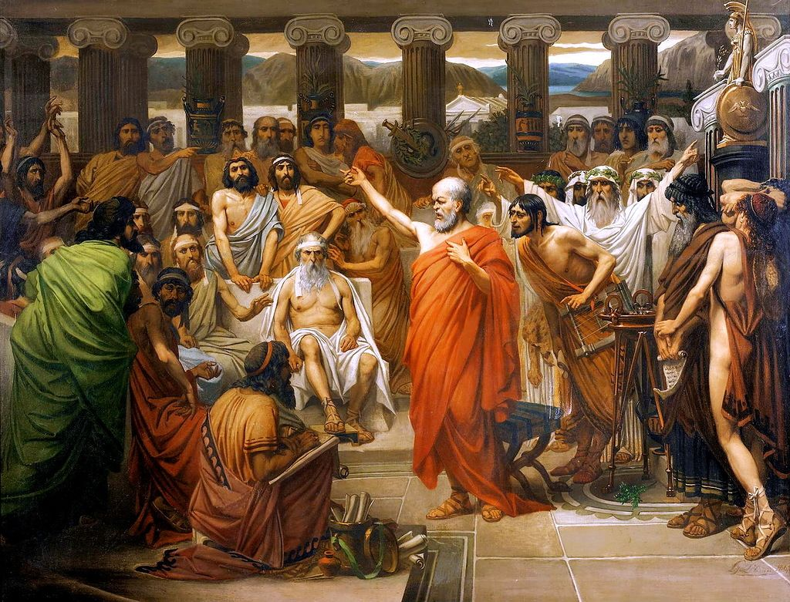

# Justice in Ancient Greece

I have posted my
[introduction to Justice in Ancient Greece](https://gcallah.github.io/TheIdeaOfJustice/AncientGreece/intro.html).
It is the introductory lecture for my spring 2027 class, *Justice in Ancient
Greece*, at the University of South Carolina.
