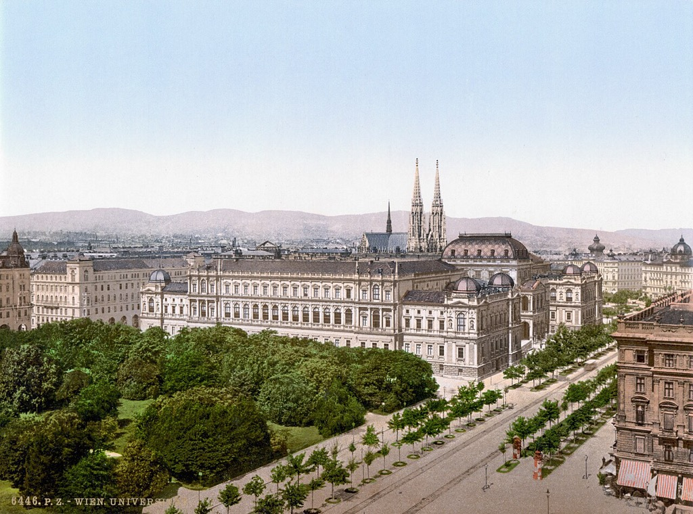

# Who is Eric Voegelin to me?

{: style="width: 67%; display: block; margin: 0 auto"}

One thing I haven't discussed with you much is my main intellectual
influences. I think it's worthwhile to take some time to introduce you to each
of them.

We'll start with Eric Voegelin first, because he's a little easier to tackle. I
began reading him because my PhD advisor, David Boucher, told me that Oakeshott
had told him, "Look into the works of Eric Voegelin." I think he was
essentially passing Oakeshott's assignment on to me.

I started to do so, beginning with *The New Science of Politics*. I was
immediately hooked. Voegelin is a masterful scholar, in addition to being a
penetrating thinker. Those two things don't necessarily go together: there are
people who are excellent at digging up some obscure reference in Arabic to
prove what Averroes really thought about divine simplicity, but do not really
have any major ideas of their own. And then there are people like Michael Oakeshott, the other thinker
I will discuss with you, who is brilliant but not particularly interested in
scholarship. Voegelin was a master in both worlds. For example, as far as I know, he
could read German, English, French, Italian, Ancient Greek, Latin, Hebrew,
Sanskrit, and Chinese.

A marvelous example of Voegelin's scholarly diligence is the section on Henry
James's work, "The Turn of the Screw," in Voegelin's collected works. When the
section starts, Voegelin has just read "The Turn of the Screw," and is barely
familiar with the works of James. By the time the section ends, in writings
from a few years later, he is a master of James's oeuvre, to the extent that you
could easily see him teaching a course on James.

Sometimes this meticulousness got the better of him. In the late 1930s, he
contracted to write a short history of political thought for an academic
publisher. (You can easily find the details in the Collected Works: this is a
blog post, so I'm not going to put in references here.) The book was to be 200
pages, and delivered in 1 year. Somewhere in the collected works, there is
documentation of the progress of the correspondence between Voegelin and his
publisher. While I'm making up the particular dates and numbers, my
chronology below is essentially truthful to the spirit of what occurred:

1938: Voegelin contracts to deliver a 200-page history of political thought in
1939.

1939: Voegelin tells the publisher the book is now 300 pages and won't be
finished for another year.

1941: Voegelin tells the publisher that the book now must be at least two
volumes, and will be delivered by 1944.

1943: Voegelin tells the publisher that the work is now four volumes and over
1,200 pages, and will be finished in "a year or two."

Somewhere about 1946 or so, the work had reached seven volumes in scope, and
the publisher finally gave up. At that point, Voegelin simply set aside the
huge amount of work he had done on the project, and immediately launched into a
new, five-volume history of order. One must be a bit of a maniac to do that
sort of thing. (And I'm not saying anything against him in pointing this out,
because in general, I like maniacs.)

He continued work on this project almost up to the day of his death, dictating
his final essay to one of his students, as he was dying.

Summing up such a vast body of work in a sentence or two always means leaving a
lot out. But if I were to summarize what I admire in him, it would be his
relentless meditation upon the transcendental source of order in the human
world.
