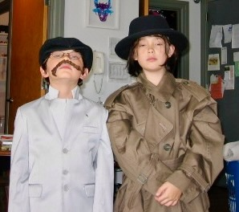

# Nick Danger, Third Eye

Firesign Theater was a very amusing comedy group that released records in the
1970s. One of my favorites was *The Further Adventures of Nick Danger, Third
Eye*. I occasionally have signed up for online services using "NickDanger" as
my username: a decent cyber-stalker would easily be able to find instances of
me appearing as Nick Danger, but you, dear reader, most likely won't be able
to.

Well, it seems that my children, Emma and Adam, also found the record amusing.
And one day, we decided to make a recording of a portion of it. Emma and Adam
dressed the parts: Emma is appearing as Nick Danger, and Adam is playing Rocky
Rococo.

{: style="width: 67%; display: block; margin: 0 auto"}

Here are Emma and Adam playing their parts
([listen on SoundCloud](https://soundcloud.com/gene-callahan-1/nickdanger-1)):

<iframe width="100%" height="166" scrolling="no" frameborder="no" allow="autoplay" src="https://w.soundcloud.com/player/?url=https%3A//soundcloud.com/gene-callahan-1/nickdanger-1&color=%23ff5500&auto_play=false&hide_related=true&show_comments=false&show_user=true&show_reposts=false&show_teaser=false"></iframe>

And here is
[the original record](https://youtu.be/RwG5c9IsgbA?t=83)... The part the kids
are doing starts at about 1:20 and ends at 3:25.

<iframe style="position: absolute; top: 0; left: 0; width: 100%; height: 100%;" src="https://www.youtube.com/embed/RwG5c9IsgbA?start=83&end=205" title="The Further Adventures of Nick Danger, Third Eye" frameborder="0" allow="accelerometer; clipboard-write; encrypted-media; gyroscope; picture-in-picture; web-share" allowfullscreen></iframe>

