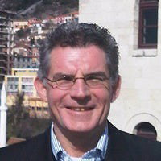
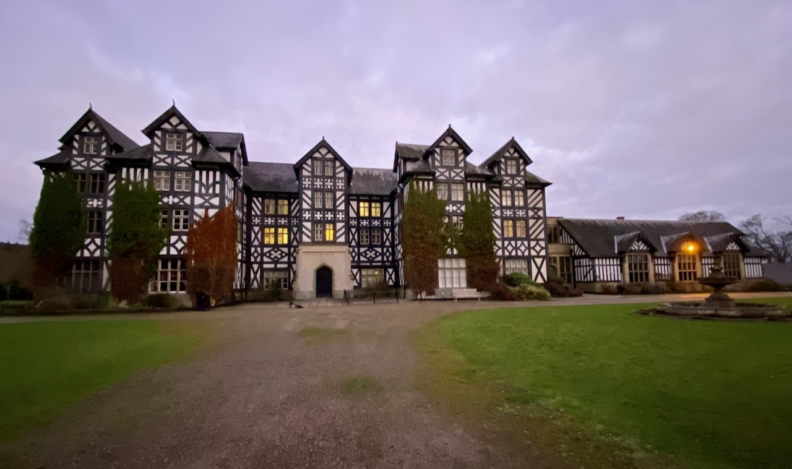
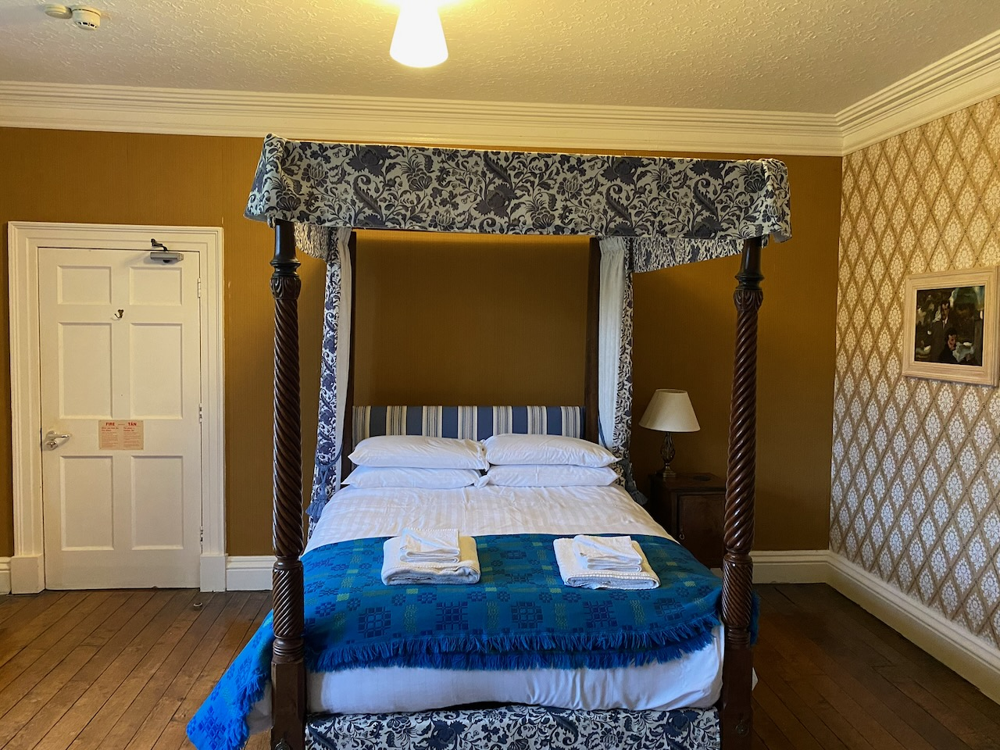
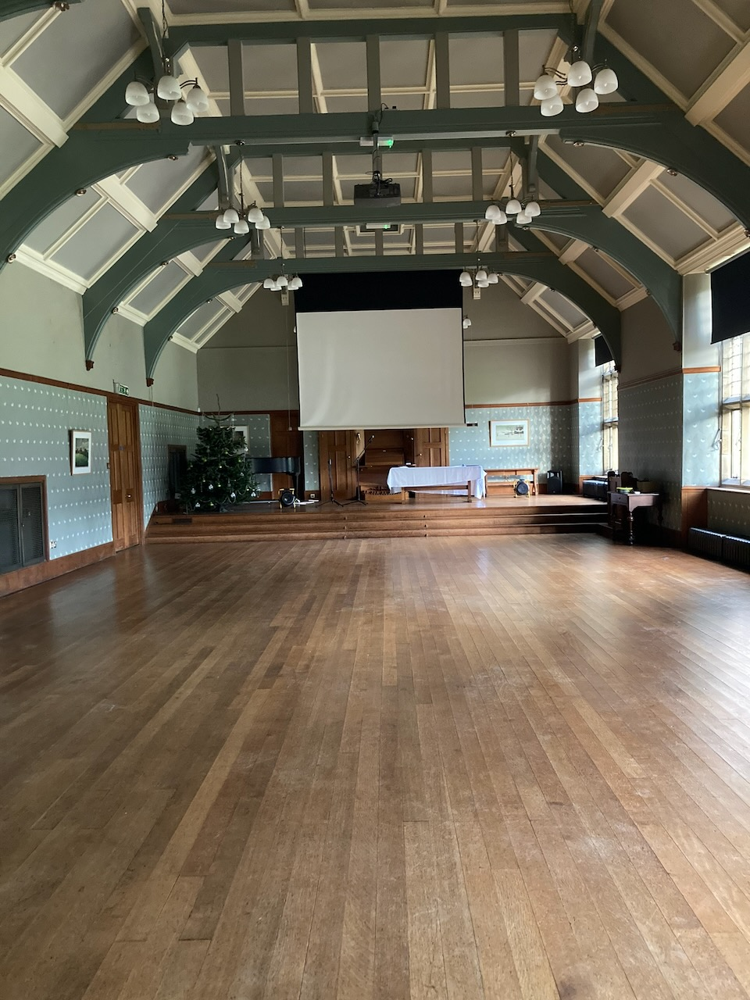
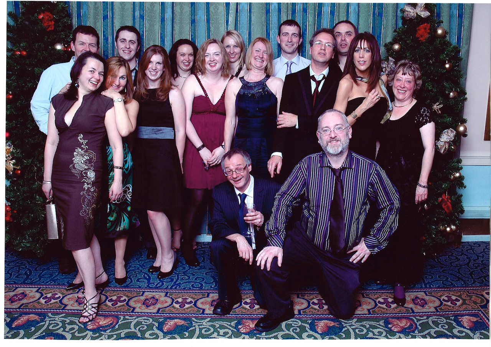
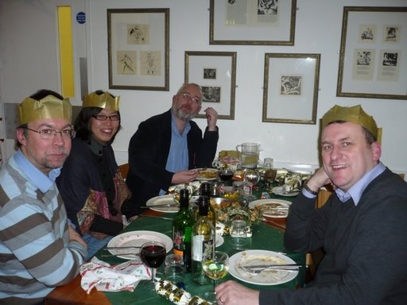

# The British Idealists

Philosophical idealism is not particularly easy to define. But to give you a
basic sense of it, one thing in common with the various thinkers called
idealists is that they all hold that, to one extent or another, mind is a
fundamental aspect of reality. They differ from materialists, who have a very
difficult time explaining why anything mental actually exists in a world that
is supposed to be purely physical. And they also differ from dualists, in that
they generally do not hold that mind and matter are completely separate things,
but somehow part of one unity.

Michael Oakeshott, the fellow who I did my PhD thesis on, is generally counted
as a member of the group of philosophers called "British Idealists." And
through my study of him, and my heading to Cardiff to do a PhD with David
Boucher, I got to know the members of the British Idealism Specialty Group.

*David Boucher*

I have attended several of their conferences at Gregynog Hall in Wales, as well
as conferences of the British Political Science Association in Belfast and
Manchester, where the idealists held a mini-conference within the larger
conference, and a British and Italian idealism conference in Genoa. (That's
where I met my friend Spartaco Pupo, by the way.)

Gregynog Hall is a great place for a conference. It is a large mansion that was
once owned by the Davies sisters, who created a center for the arts at the
house. They were great collectors of modern French painters, and while most of
their collection apparently has moved to a museum in Cardiff, you still might
find a painting by Manet on the wall of your bedroom when you stay there. We
would hold our conferences there because the younger of the sisters had donated
the house to the University of Wales in her will.

{: style="width: 67%; display: block; margin: 0 auto"}

{: style="width: 50%; display: block; margin: 0 auto"}

There is a pub in the basement of the hall. Or at least there was: last trip
there, we never went down to it. They used to just open it to conference
attendees and let them serve themselves, until whenever they wanted to retire
for the evening. Apparently, my friends Pete and Peri ruined this arrangement
by not wanting to retire until 9:00 am in the morning, and then heading straight
from the pub to the first paper presentation of the day, which apparently went
somewhat worse for their being there.

Here are my friends James Connelly, Chinatsu Kobayashi, and Colin Tyler at
Christmas dinner. For some reason, they each got a silly Christmas hat, while I
did not.

Colin and I immediately established the same sort of relationship that Larry
and I have: constant, good-natured razzing of each other. For instance, at our
first dinner in Genoa, Colin got served before me. Sitting across the table
from me, he began eating. But after a few seconds, he looked up at me and
asked, "Gene, do you know why this food is so good?"

"No, I don't."

"Because I have it and you don't."

So clearly, we aren't the sort of idealists who are constantly imagining a
perfect world.
