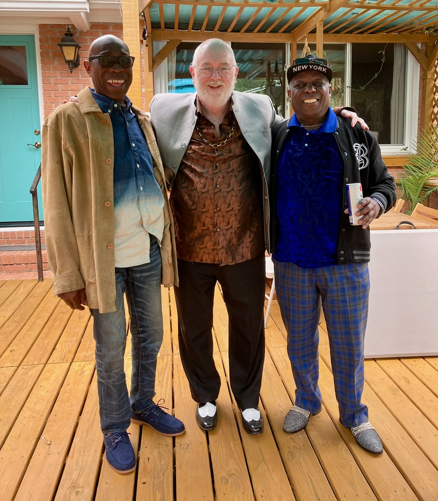

# Bishop and Dellie

{: style="width: 67%; display: block; margin: 0 auto"}

*Dellie and Bishop*
{: style="text-align: center; margin-top: -1rem"}

The first time I met Bishop one of my early reggae bands was playing at a West
Indian social club in Stamford. Our drummer was [Martin
Obeng](https://music.brown.edu/people/kwaku-kwaakye-martin-obeng), my drum
teacher, who was a master drummer from Ghana. Martin was an excellent drummer,
but not a conventional reggae drummer at all. He liked to play very complex
rhythms and was often essentially soloing throughout an entire song.

Well, the reggae purists in the audience did not like this one little bit. Some
friends of ours had come to see the show, and when we took a break, they told
us that they had heard several of the other attendees saying that they wanted
to shoot the drummer.

We did not know Bishop at all at that point, but he rescued us by stepping up
and doing lead vocals on several songs. This calmed the crowd, and we managed
to get out with our drummer still alive.

A few years later, Clayon met Bishop and Dellie somewhere, and discovered that
they were looking to form a band. Bishop, besides being a vocalist, is also an
excellent drummer, and Dellie is a great guitar player. We already had bass,
keyboards, and percussion, so the fit was very good, and we played together
with that formation for a couple of years.

Dellie was the master of creating nicknames that stuck. As mentioned in a
previous post, it was him that named
[Rudolph Sock]() "King Rudolph." Clayon
was "The Captain," and I was "Mean Gene." Years later, our friend Chris asked me, "Who gave you the name
Mean Gene anyway? Dellie?"

"That's right," I said.

"Yeah, Dellie gives everyone their nickname."

I left the group after a couple of years, partly because of living
circumstances, and partly because of my difficulties in getting along with the
bass player, Paul. Later, Bishop and Dellie left the group for much the same,
latter reason. They formed a new band called Profile, and I played with them
for several years.

A fellow named Culture was the drummer in that group, and Bishop only sang.
Bishop and Dellie and Derek, who just passed away, did not smoke herb. Bruce,
the bass player, did, but we were not allowed to smoke with him, because, as
Bishop said, "Gene, if Bruce smokes, him forget everything." So that left it up
to me and Culture to maintain our honor as a reggae band.

We had an afternoon gig in South Norwalk, and on the set break, Culture and I
would go out to his car and share a spliff. And every time we did, Culture
would make me put on a bunch of cologne, and do so himself, so we would not
smell like herb when we went back to the club. After a few weeks of this, I
said, "Culture, okay, so they don't think we're smoking out here. Instead, they
see two men head to a car in the parking lot every week, and come back smelling
like the exact same cologne. So you know what they think we're doing instead?"

Culture's eyes grew wide, and he said, "Ras clot, no!"

I don't think he made me put on the cologne anymore after that.

I continued to see Bishop off and on after I left Profile. In fact, a couple of
years ago, he called me and asked if I could buy him a house in Connecticut. He
was stuck for a place to live, and that seemed like a good solution to him. I
told him I had just bought a house, and couldn't really buy another at that
moment, but he could always come stay with us for as long as he needed to.

But I don't think I saw Dellie for over two decades, until last year, when he
came down to play at our house in South Carolina. The picture at the top is
from that day.
