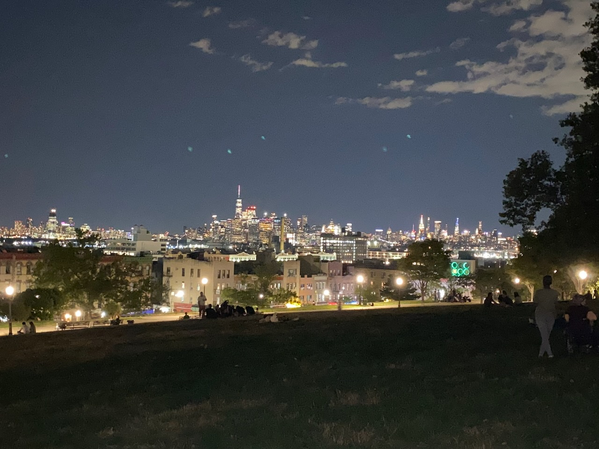
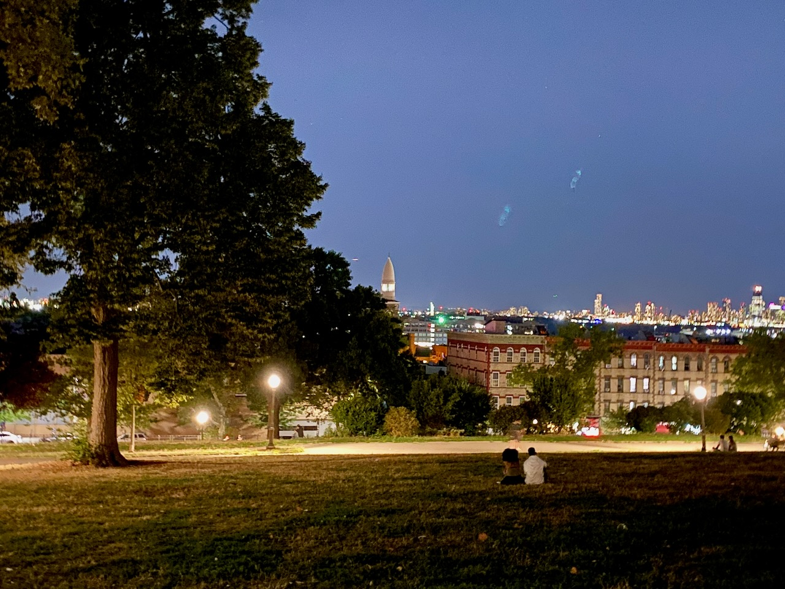
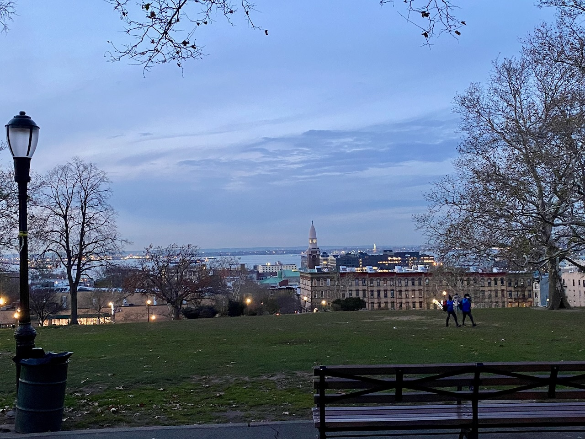
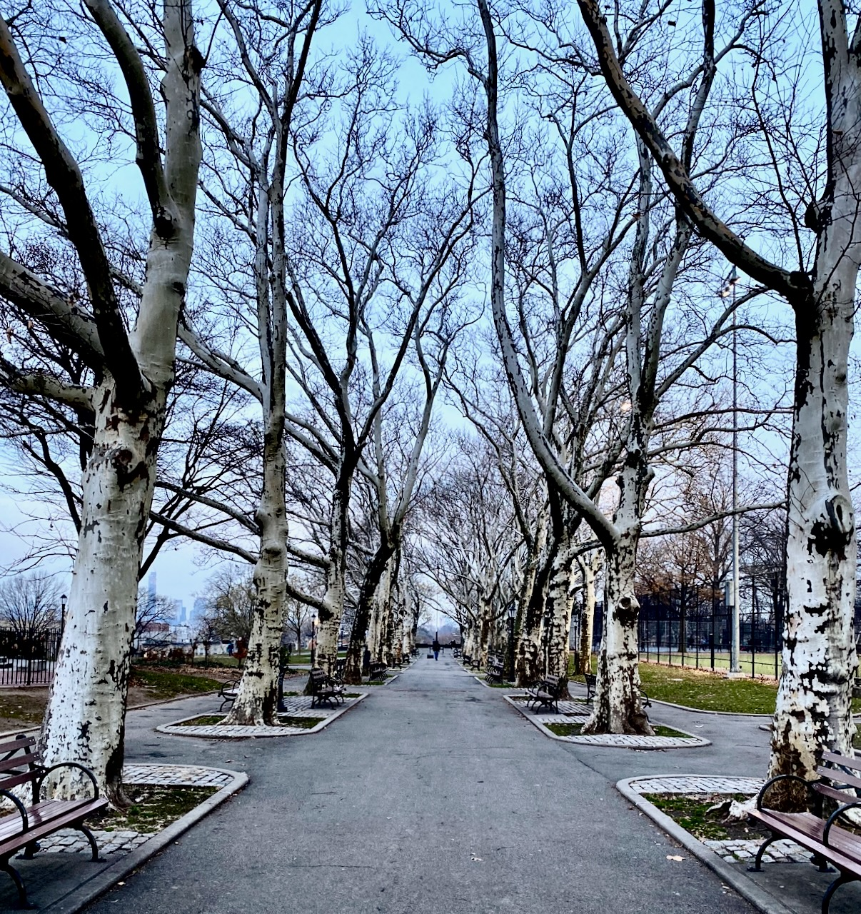
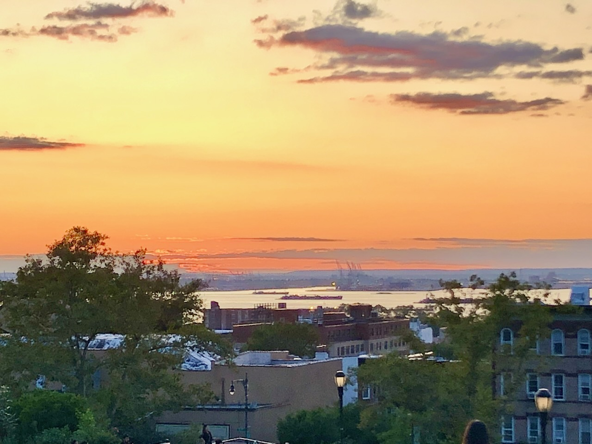
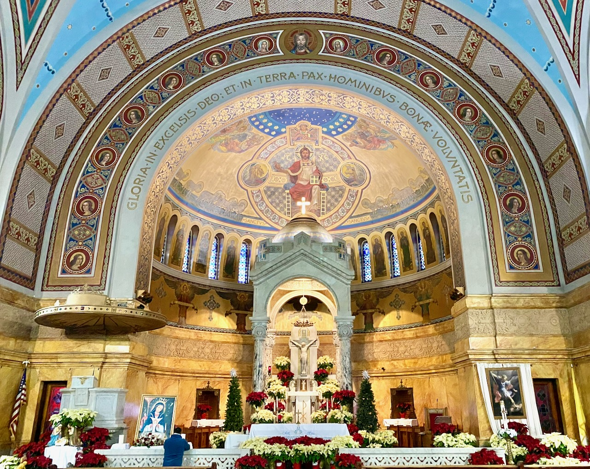
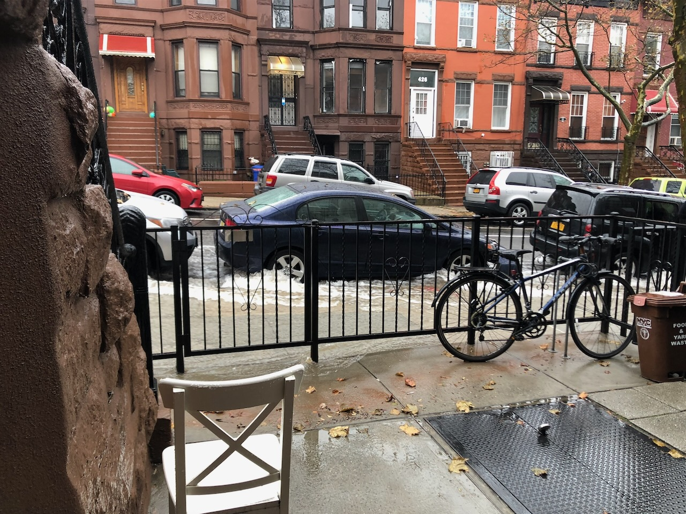
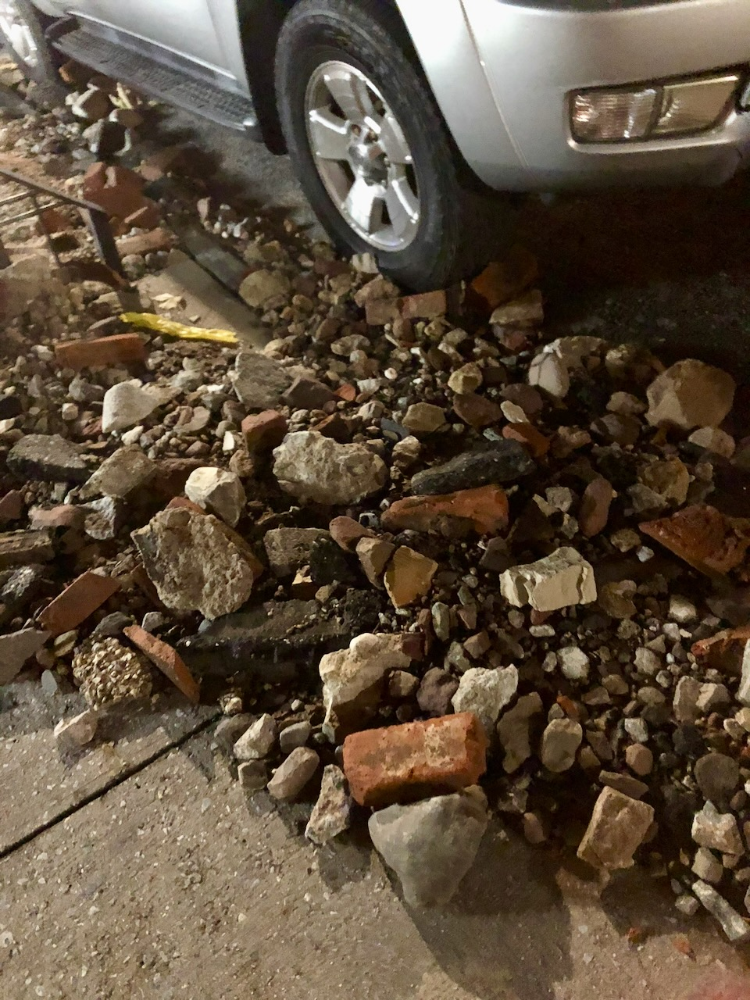

# Sunset Park

The last neighborhood we lived in in Brooklyn was Sunset Park. Our half of the
neighborhood, the western half bordering New York Harbor, was probably 90%
Hispanic. The eastern half, on the other hand, was primarily Chinese. This
meant in our immediate neighborhood, we had an amazing variety of Mexican,
Colombian, Salvadoran, Honduran, Guatemalan, and other restaurants. Or we could
walk about 10 minutes and be in Brooklyn's Chinatown, and have a large
selection of authentic Chinese places to choose from, as well as many Chinese
grocery stores, selling food items I had never seen before in my life.

The neighborhood is named after a park called, surprisingly, Sunset Park. In
another surprise, it has great views of ... the sunset! But also views of New
York Harbor, the Statue of Liberty, New Jersey, and Lower Manhattan. The park
was busy about 16 or 18 hours a day, I think. There would be large groups of
mostly older, mostly female Chinese people doing tai chi or some form of
exercise dance. Lots of people would just sit on the hillside and look out at
the harbor, but there also were typically volleyball games, soccer games, and
basketball games going on. There was also a huge pool that was open during the
summer months.

{: style="width: 67%; display: block; margin: 0 auto"}

{: style="width: 67%; display: block; margin: 0 auto"}

{: style="width: 67%; display: block; margin: 0 auto"}

{: style="width: 67%; display: block; margin: 0 auto"}

{: style="width: 67%; display: block; margin: 0 auto"}

The church we went to was only half a block from our house. It was a very
beautiful church.

{: style="width: 67%; display: block; margin: 0 auto"}

One day, we came back from Pennsylvania to Sunset Park to find that our street
had turned into a river. Apparently, a water main had broken uphill from us and
was pouring water down several of the side streets, including ours. The flood
carried all sorts of pieces of brick and stone down the street, and they formed
a pile at the bottom of our block that stayed there until we moved out of the
neighborhood two years later.

{: style="width: 67%; display: block; margin: 0 auto"}

{: style="width: 67%; display: block; margin: 0 auto"}
