# India

When we landed in India, a driver picked us up at the airport. He wound up
being with us for our entire stay. He first drove us from the airport in Delhi
to the city of Agra, which is most famous for the Taj Mahal. Of course, there
are a lot of tourists there, but still, it is a magnificent sight.

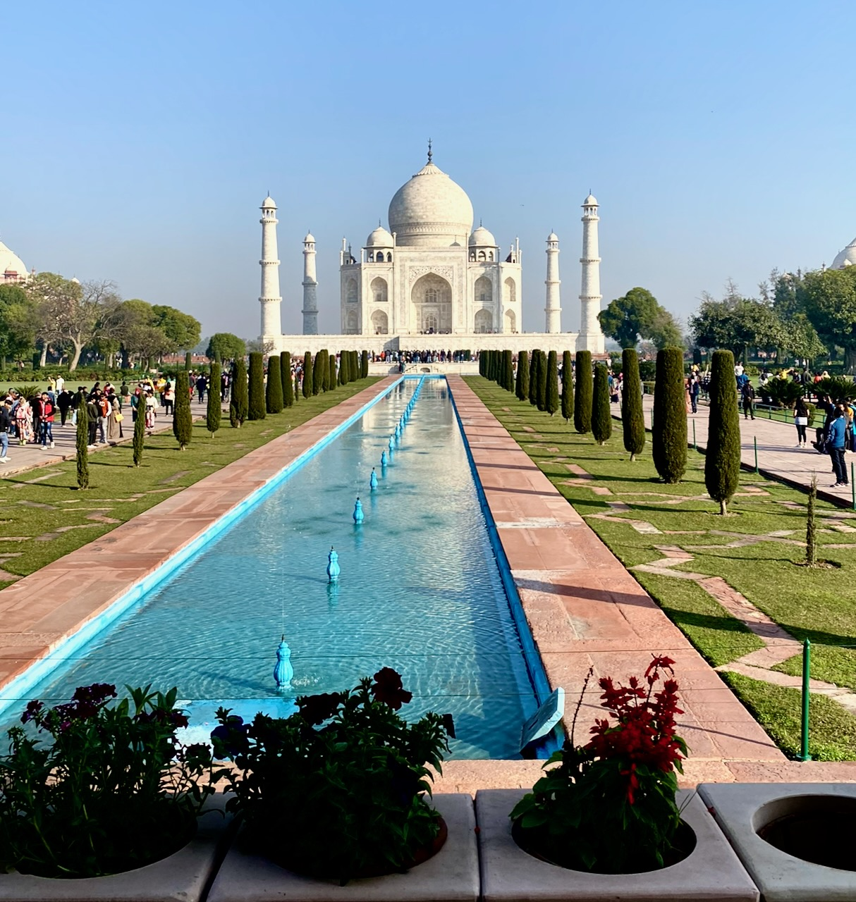{: style="width: 67%; display: block; margin: 0 auto"}

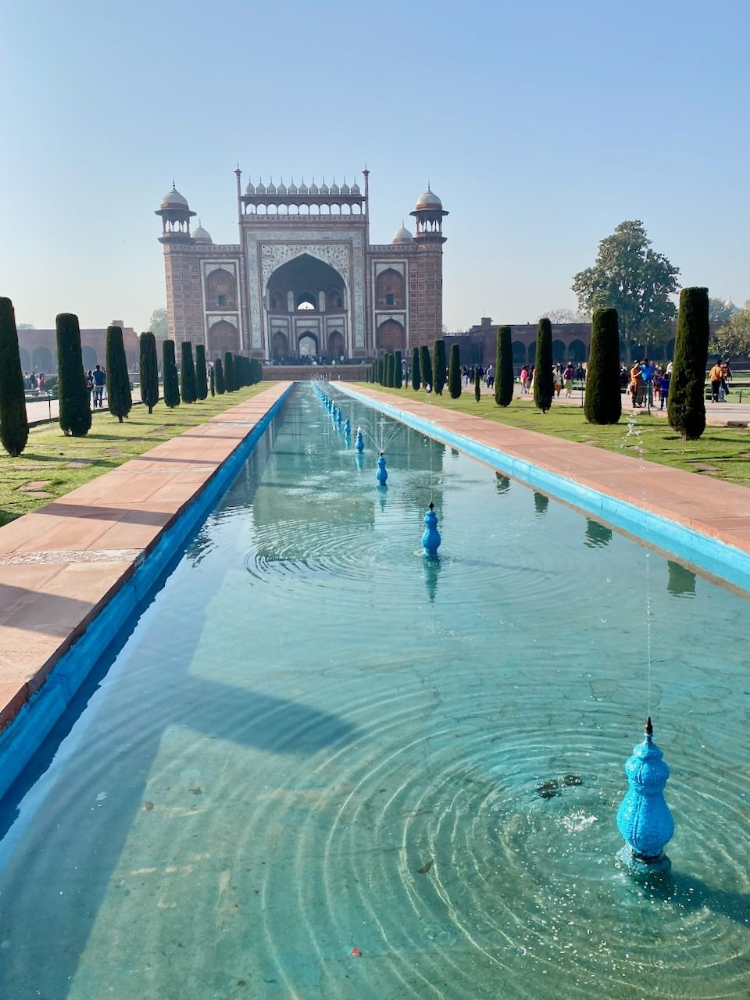{: style="width: 67%; display: block; margin: 0 auto"}

Besides tourists, there are also an awful lot of monkeys there, like pretty
much every other place we went in India. They are very used to humans, and will
steal things from tourists, such as glasses and cell phones, and demand food
from them in order to give them back. The Taj Mahal was so concerned about the
monkeys that they had this sign up:

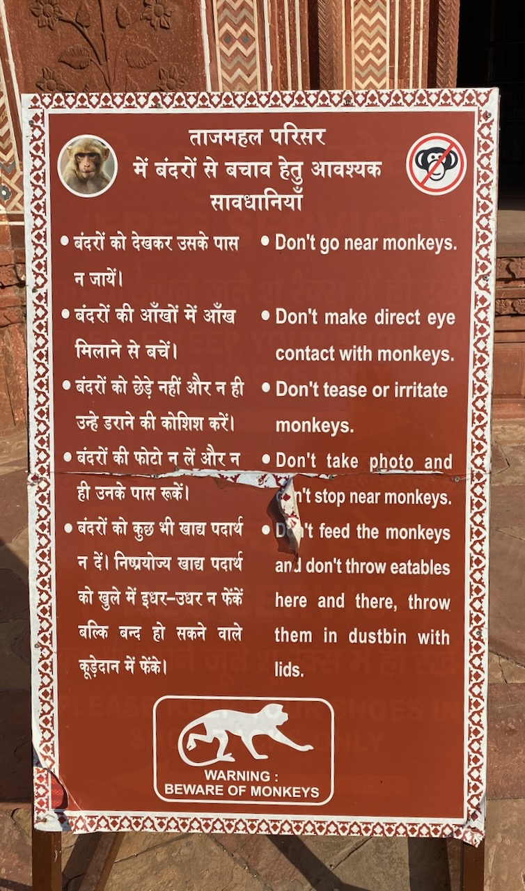{: style="width: 67%; display: block; margin: 0 auto"}

Here are some more monkeys:

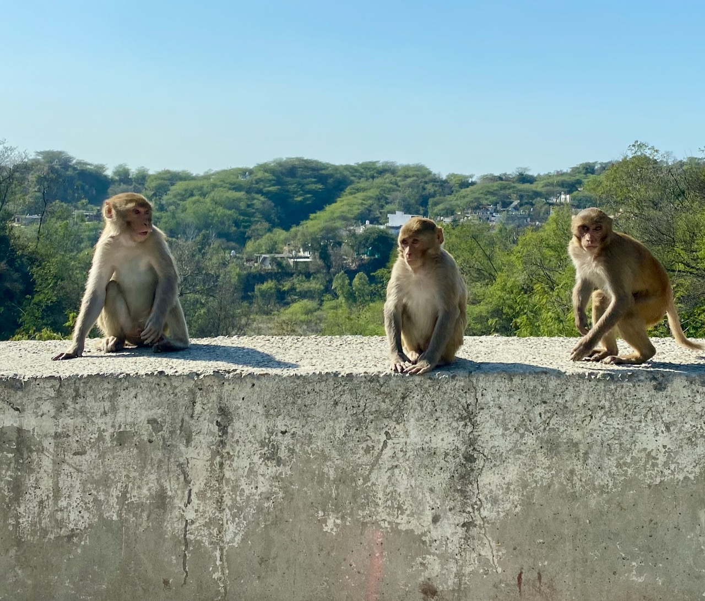{: style="width: 67%; display: block; margin: 0 auto"}

Agra Fort is the other major tourist attraction in Agra. It is also a very
impressive place.

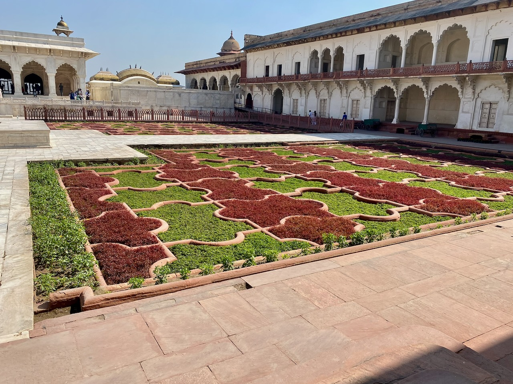{: style="width: 67%; display: block; margin: 0 auto"}

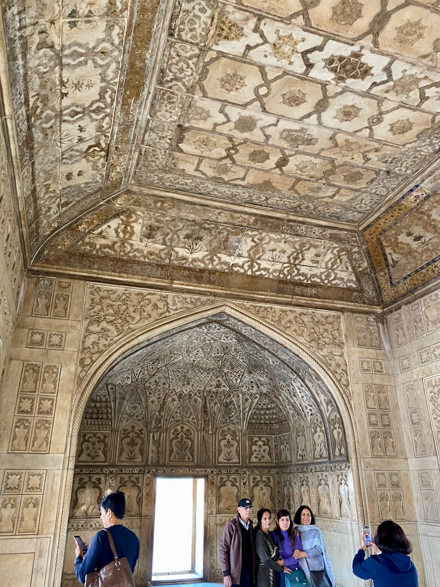{: style="width: 67%; display: block; margin: 0 auto"}

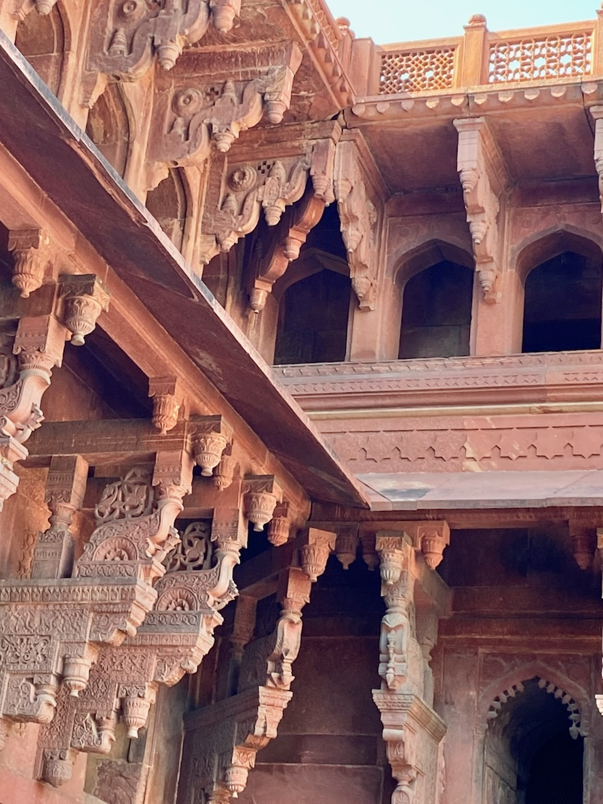{: style="width: 67%; display: block; margin: 0 auto"}

We only got to the foothills of the Himalayas, and only the "low" Himalayas at
that, but they were still extremely impressive. We stayed in the foothills for
a couple of days, and took a drive up to see the place the Dalai Lama has lived
since he fled Tibet.

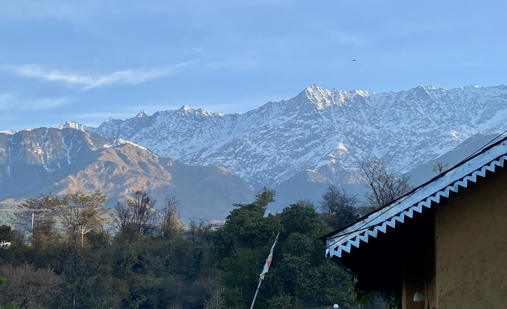{: style="width: 67%; display: block; margin: 0 auto"}

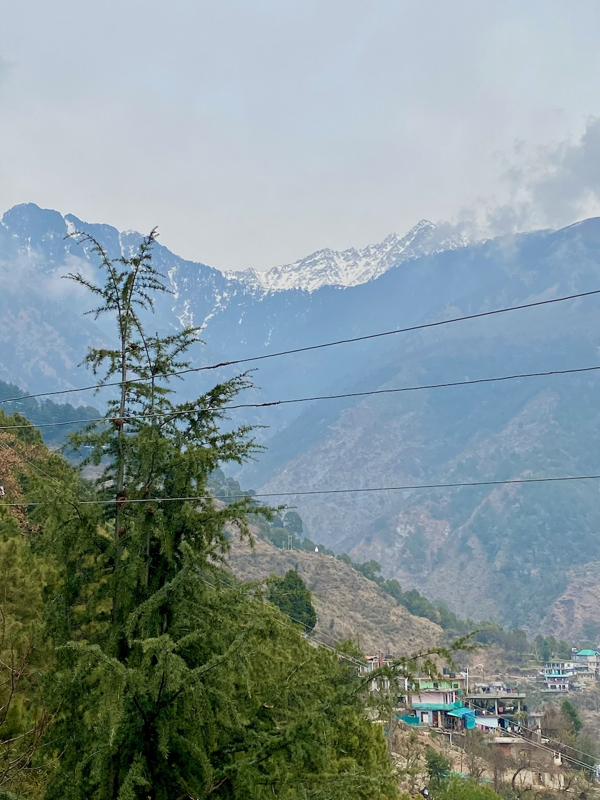{: style="width: 67%; display: block; margin: 0 auto"}

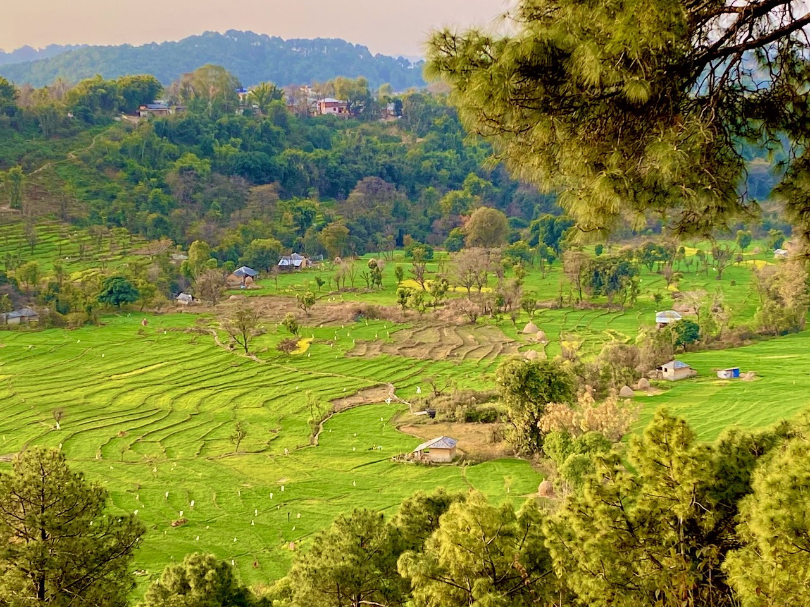{: style="width: 67%; display: block; margin: 0 auto"}

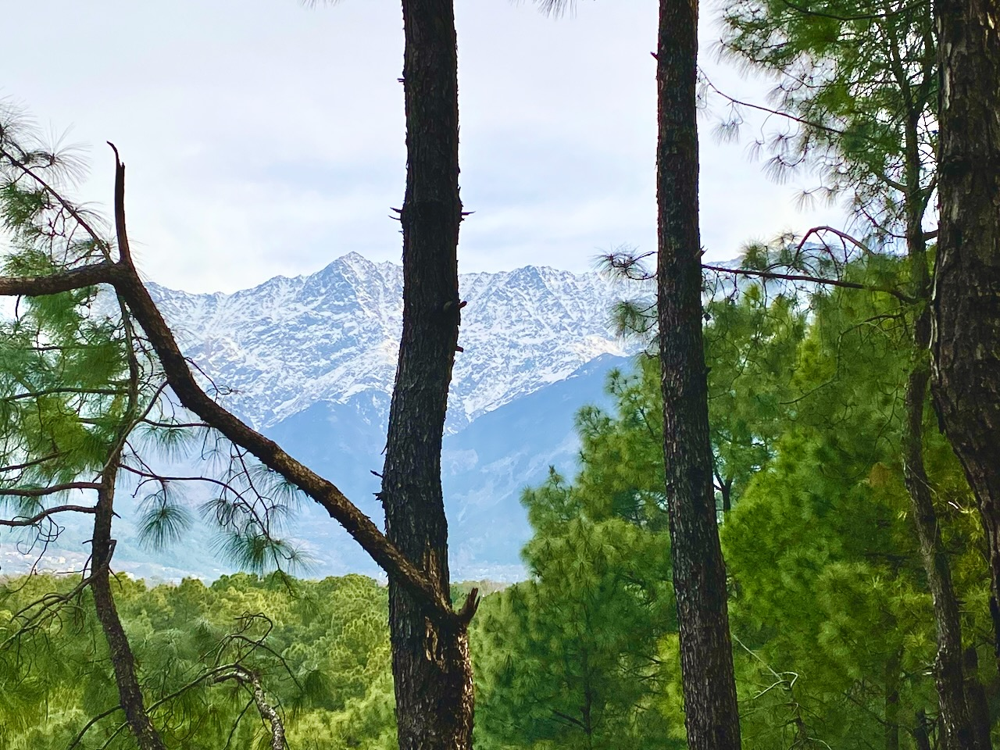{: style="width: 67%; display: block; margin: 0 auto"}

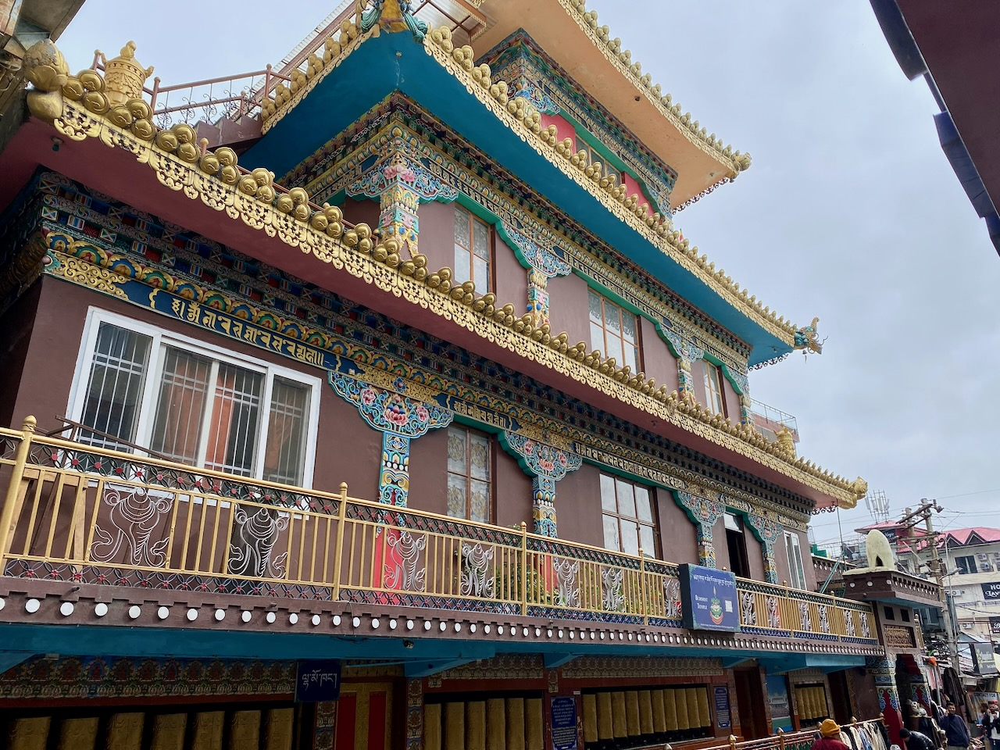{: style="width: 67%; display: block; margin: 0 auto"}

An Indian wedding, which is what we ultimately came for, is a crazy event. It
lasts about 5 days, at least in our case, with different events each day. At
one point, there was a bunch of ladies playing music along with a fellow
singing. I asked my former teaching assistant, Vivek, if I could play with
them. He checked, and they said yes. So I sat in with an Indian wedding band
for a little while.

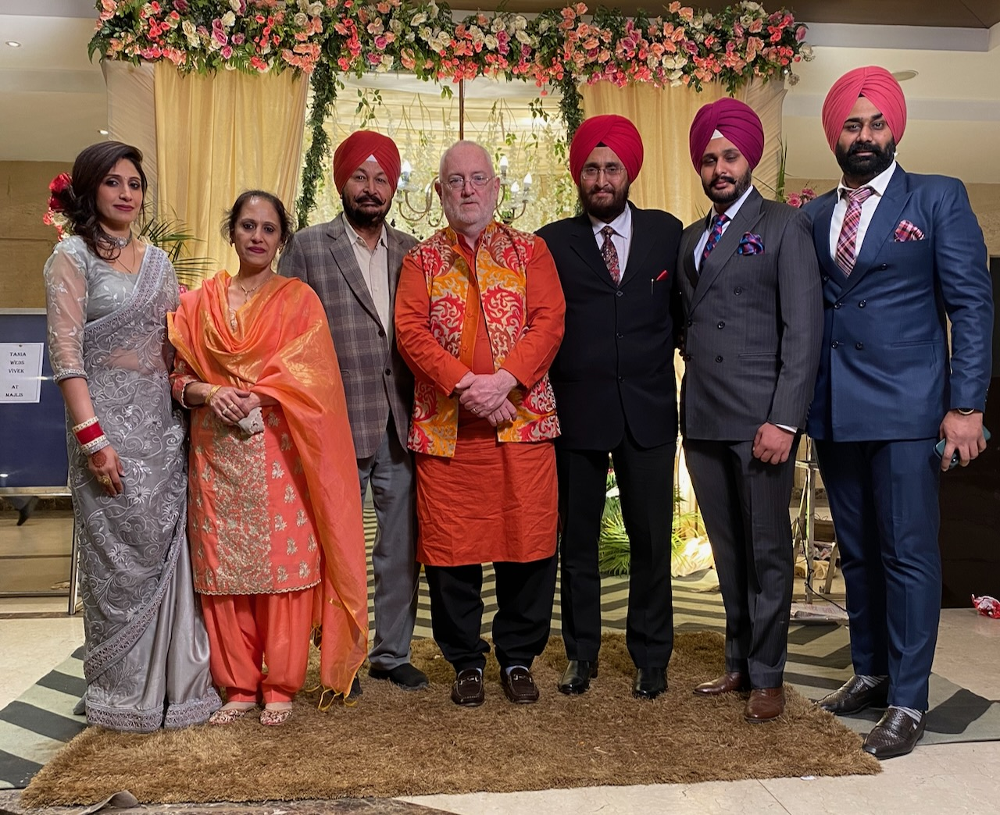{: style="width: 67%; display: block; margin: 0 auto"}

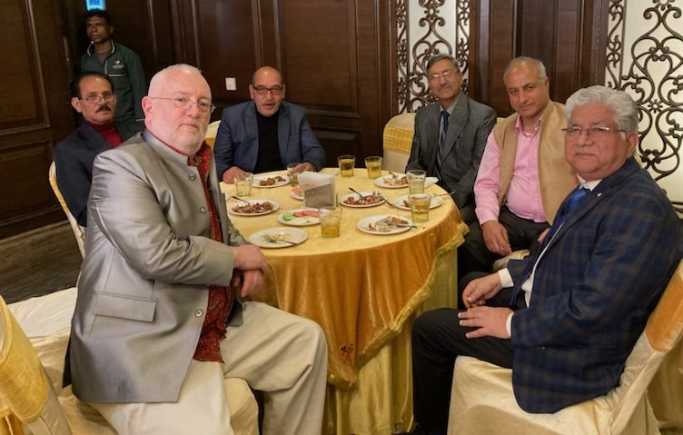{: style="width: 67%; display: block; margin: 0 auto"}

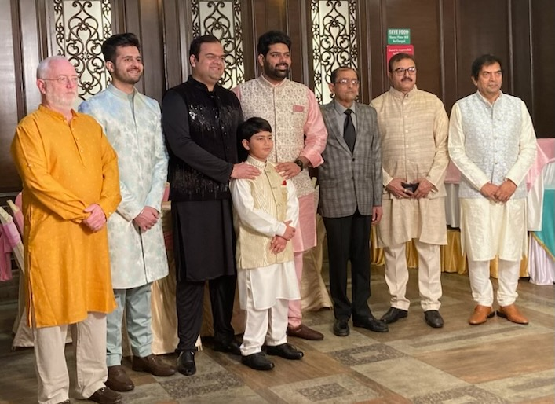{: style="width: 67%; display: block; margin: 0 auto"}
