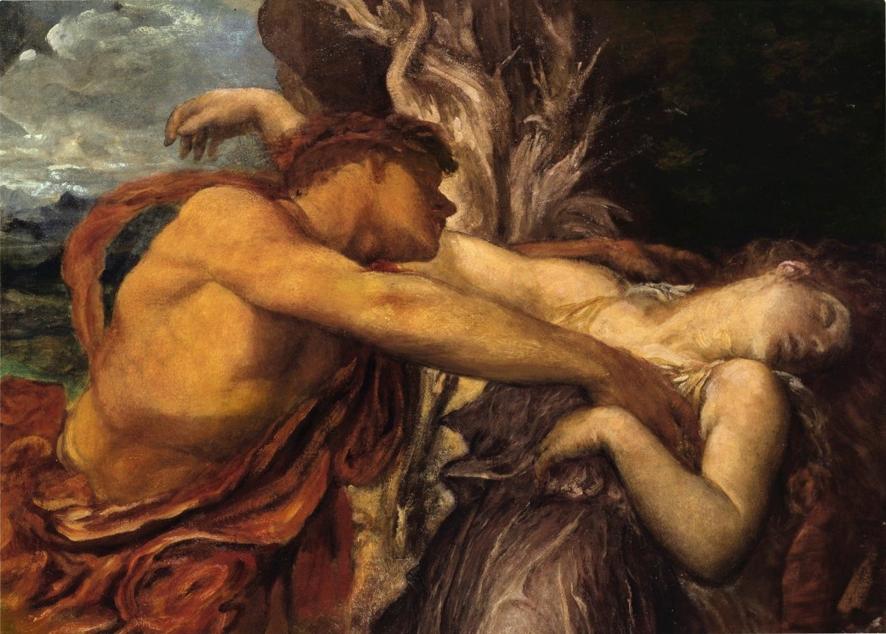

# Orpheus and Eurydice

Orpheus was deeply in love with Eurydice, but soon after they married, she was
bitten by a poisonous snake and died.

Orpheus could not accept this as final. The greatest musician in the world, he
descended into the underworld with his lyre to recover his beloved. He charmed
the boatman Charon to row him across the river Styx into Hades, and charmed the
three-headed dog Cerberus so that the beast let him pass. His playing then
brought Hades and Persephone to tears, and for the first time ever, they agreed
to let a mortal leave the underworld.

But they placed one condition on this gift: on the way back to the land of the
living, Orpheus must trust that Eurydice was still behind him, and must never
look back.

However, at one point, Orpheus thought he heard Eurydice stumble, and, turning
around to help her, he saw her disappear back into the darkness.

What is the relevance of this curious story? Well, let us say you are trying to
resurrect an old love, one that has passed from the land of the living into the
land of the dead. If, as a special gift, you are granted such an opportunity,
*you can't look back*. The moment you start looking into the past for reasons
to doubt what is going on, you have lost: you will never make it back to the
land of the living together.

I once found myself in such a situation. And I knew the rule, and I thought I
was being wise and careful, and not looking back. But I forgot: I wasn't the
only one who could look back. And I stupidly forgot to tell her the rule.

And she looked back.

{: style="width: 67%; display: block; margin: 0 auto"}
