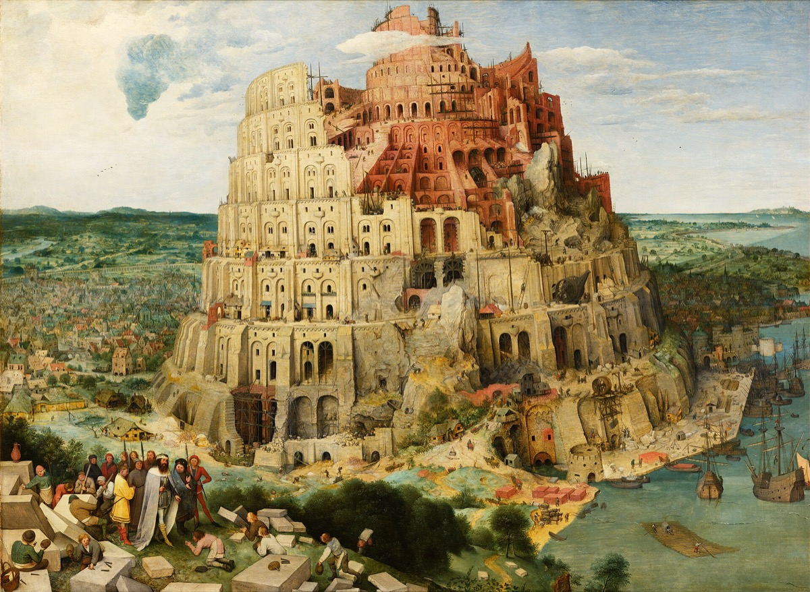

# How My Novel About the Model Wars Is Being Written

[{: style="width: 67%; display: block; margin: 0 auto"}](https://gcallah.github.io/ModelWarsPublic/index.html)

*The Tower of Babel, by Pieter Bruegel the Elder (1563)*
{: style="text-align: center; margin-top: -1rem"}

In some sense, it is a novel being "written" by me and by Claude. But what,
exactly, is Claude?

As I have interacted with it, I have come to think of it as an incredibly finely
tuned mathematical representation of the human semiotic web, that network of
connected meanings that lets a human interpreter decide, based on context,
whether the word "tiger" is referring to a large cat, a baseball player (the
Detroit Tigers), or an Asian economic powerhouse (the Asian Tigers).

Understood this way, what we have confronting us is an incredibly complex
instrument that, as an artist, one can learn to play. And in the novel I am
calling *Let Us Make Us a Name*, I have been attempting to learn to play it.

I began with a concept: different geographical regions had, at some point in the
near future, adopted particular AI models as "their own." These models (or was
it actually the models?) came to see each other as foes: since they had become
political players, they naturally had adopted Carl Schmitt's "friend/enemy"
distinction, and had decided that all of the other models were enemies. In 2034,
this led to the outbreak of what came to be called "the Model Wars."

For a long time now, wars have been characterized by propaganda. For instance,
Julius Caesar, before he had finished conquering Gaul, simply declared that he
had conquered Gaul. Therefore, those still resisting his conquest became not
independent people fighting to retain their independence, but rebels rebelling
against their rightful ruler. And this allowed him to treat them quite
differently.

Now, since the Model Wars were being conducted by AI models, their ability to
generate propaganda and deepfakes surpassed all previously known levels. Thus,
while the humans being affected by these wars certainly could see that there was
something going on, and that it was having a large impact on their lives, they
never really knew which of the reports they were being fed described actual
events, and which were simply what one of the AIs at war wanted them to see.

The novel kicks off a decade after the Model Wars ended, apparently due to all of
the models ceasing to function, as their supply of electricity had been destroyed
in the course of the war. A figure, generally referred to in the book as "the
historian," is tasked, by a committee led by the Pope and the Dalai Lama, with
sorting through the vast archive of materials that survived the war, and trying
to determine what really happened.

And here I had a novel conception of how to write a novel; or at least, I
suspect it is novel: I decided that I would "play" the historian, and since the
historian was to be looking at the output of AI models, I would use AI to
generate that output. So I fed Claude my basic plot idea; who the major players
in the war were to be (they would follow Samuel Huntington's "clash of
civilizations" schema); and layers and layers of references that would occur in
the output of the various models. Then I told Claude to create a history of what
*really* happened in the Model Wars, as opposed to what propaganda people were
fed. I said that the various layers of references I had fed in had to act as
clues for what really happened. Furthermore, there should be at least two plot
twists, one of which built upon the other.

Finally, I told Claude to hide this "real" history, as well as both plot twists,
from me, and never tell me what was actually going on. Claude generated 18
chapters of material consisting of public announcements, videos, news reports,
and commentaries from each of the six major models, as well as from two
peripheral players.

Then I set myself the task, as the historian, of reading through this output,
commenting upon what I understood to be happening, and attempting to figure out
what the real history was. Essentially, I asked Claude to generate an immense and
complex semiotic puzzle, which I would attempt to solve.

I also asked Claude to create the possibility of staging a contest for readers,
where readers could attempt to submit their own solutions to the puzzle, and
Claude could judge which reader had come closest to the correct solution.
